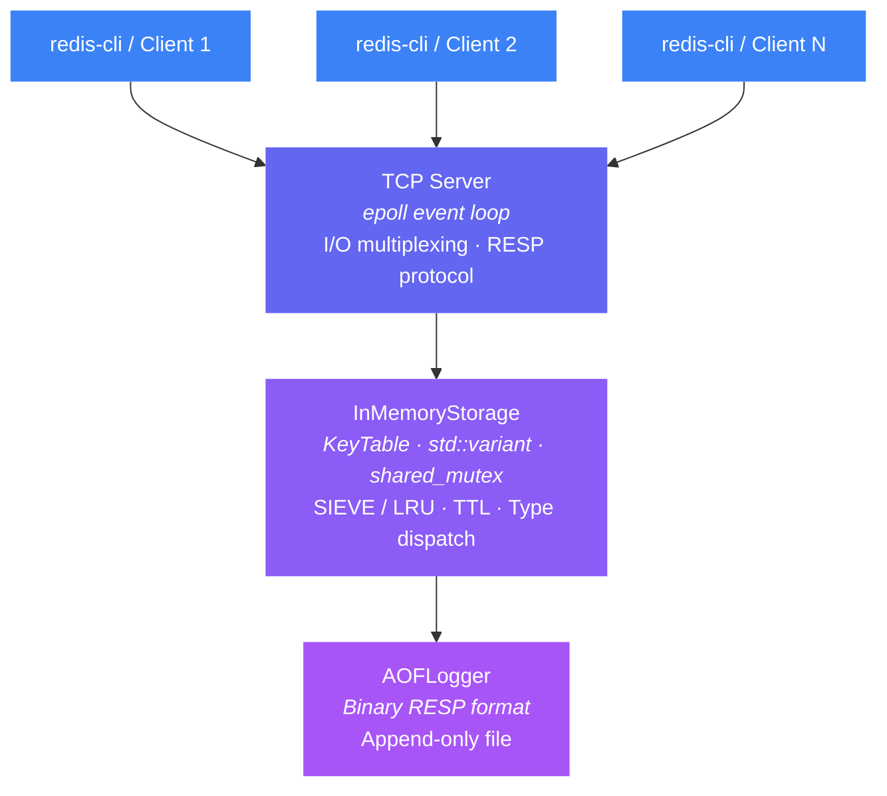
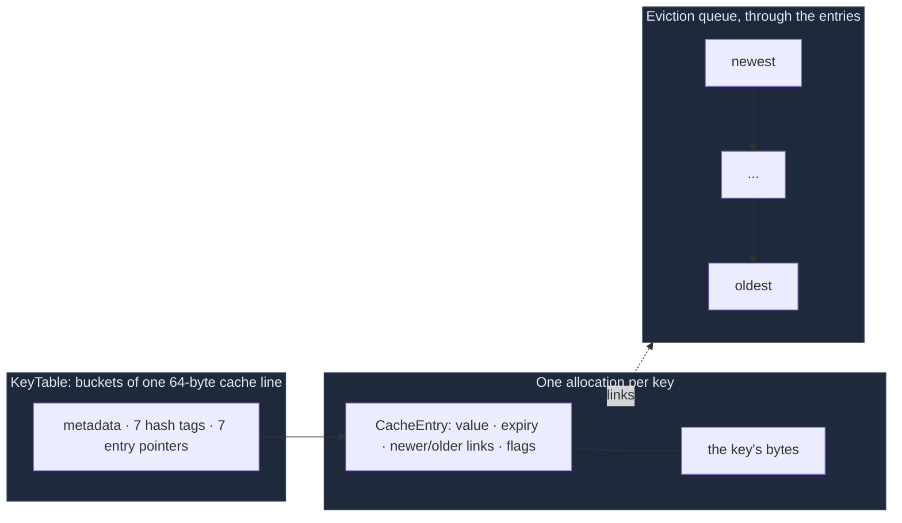

# Kosh — Redis-Compatible In-Memory Key-Value Server in C++17

*Kosh (कोश) is Sanskrit and Hindi for a treasury: a store of valuables. Formerly Mini-Redis.*

[](https://github.com/madhavthesiya/kosh/actions/workflows/ci.yml)

A Redis-compatible server built from scratch in **C++17**: a **TCP server speaking RESP2 and RESP3** (works with `redis-cli` and `redis-benchmark`, and with client libraries that open with `HELLO 3`, as redis-py 8 and node-redis 6 do), a **single-threaded epoll event loop with non-blocking sockets and per-client reply buffers**, **append-only-file (AOF) persistence with group commit and a configurable fsync policy**, **4 data types**, a **hash table of its own with cache-line buckets and incremental rehashing**, **SIEVE eviction** (NSDI 2024; exact LRU on request), **lazy TTL expiration**, a **reader–writer-locked storage engine**, and **no heap allocation per request** once warmed up.

This is a learning project, not production software. What it does not handle yet is listed under [Known Limitations](#known-limitations).

## Quick start

On Linux, with Git, CMake 3.16+ and a C++17 compiler:

```bash
git clone https://github.com/madhavthesiya/kosh.git && cd kosh
cmake -B build && cmake --build build -j --target kosh-server
./build/kosh-server                       # then, in another terminal: redis-cli ping
```

Or with Docker, no compiler needed:

```bash
docker build -t kosh https://github.com/madhavthesiya/kosh.git
docker run -d --name kosh -p 127.0.0.1:6379:6379 kosh --protected-mode no
redis-cli ping                            # PONG
```

[Run with Docker](#run-with-docker) explains `--protected-mode no` and how to keep the data. Changes from version to version are in [CHANGELOG.md](CHANGELOG.md).

---

## Performance

Kosh against real Redis 7.0.15 on the same machine, in the same session, with the same durability (both with `appendfsync no`). Pipeline 16, 100,000 random keys, 50 clients, middle of 3 runs, the server measured first alternating from run to run. Intel Core Ultra 5 125H laptop, Ubuntu 24.04 under WSL2, GCC 13 `-O2`. Full results, commands and caveats: [after the memory-latency fixes](bench/results/after-memory-fixes/README.md) (Phase 4B). Earlier stages: [after the speed fixes](bench/results/after-speed-fixes/README.md) (Phase 4), [after the correctness fixes](bench/results/after-correctness-fixes/README.md), [after the network fixes](bench/results/after-network-fixes/README.md), and the starting point, [v0-baseline](bench/results/v0-baseline/README.md).

| Test, pipeline 16 | Kosh | Redis | Kosh / Redis | CPU per request vs Redis | At Phase 4 (`v2-fast`) | At v0-baseline |
|---|---:|---:|---:|---:|---:|---:|
| SET, AOF on | 350,435 req/s | 254,621 req/s | **1.38×** | **0.67×** | 1.21× | 0.43× |
| GET, AOF on | 407,664 req/s | 332,934 req/s | **1.22×** | **0.75×** | 1.10× | 0.56× |
| SET, AOF off | 399,584 req/s | 312,012 req/s | **1.28×** | **0.71×** | 1.00× | 0.50× |
| GET, AOF off | 391,665 req/s | 338,547 req/s | **1.16×** | **0.77×** | 0.95× | 0.48× |

What the measurements show:
- **Kosh was faster than Redis in all 12 paired runs,** with lower CPU per request in every one (0.66–0.85×) and a lower p99 in every one (3.7–4.1 ms against 4.3–5.0, medians).
  - CPU per request is the fairer measure here: Kosh ran at 81–91% of a core, so the client and the loopback network limited its throughput too.
  - Ratios to Redis move by up to ±0.10 between sessions on this machine, so the change since Phase 4 is certain where it is larger than that: `GET`, and both tests without AOF, which were at parity.
- **Phase 4B removed the waits on memory that kept `GET` at parity:**
  - **a hash table of its own** finds a key in half the time of `std::unordered_map` at 100,000 and 1,000,000 keys (Challenge 13);
  - **one allocation per key:** memory per key fell from 312 bytes to 113, against Redis's 120 at 800,000 keys;
  - **SIEVE eviction:** 13–17% fewer misses than LRU on Zipf traces.
  - Commit by commit, this session's rounds were too noisy to separate most changes; KeyTable alone resolved at 9% less CPU per request for `SET` without AOF.
- **Phase 4 made it competitive:**
  - **group commit:** the AOF records of every command in a pass of the event loop go out in one `write()`, before any of their replies; 100,000 pipelined `SET`s made 132 `write()` calls where they made 100,002;
  - **no request allocates memory:** commands are parsed into reused strings, and replies and AOF records are built straight into their buffers. [`bench/alloc_count`](bench/alloc_count.cpp) counts 0 allocations per `GET` or `SET`, where Phase 3's code made 5 and 11.
- **No freeze while the table grows:** growing to 1,000,000 keys with nothing sized up front, the slowest insert took 272–405 µs. A table that grew all at once used to freeze every client for 20 ms at 85,000 keys (Challenges 13 and 15).
- **From Phase 4's session:**
  - **with 1,000 idle clients, `epoll` uses 9–14× less CPU per busy request than `select()`**, which rebuilds and scans every socket on each wakeup;
  - **with `--appendfsync always`, both servers wait for the disk and tie**: each syncs once per pass of its event loop, about 390 `SET`s per `fdatasync()` at pipeline 16;
  - **without pipelining, the two tie** (1.08× for `SET`, 0.98× for `GET`): neither server reaches 100% CPU, and the network round trip sets the pace for both;
  - **startup, replaying a 1,000,000-command AOF (45 MB):** 0.68 s against Redis's 0.64 s.

Raw numbers vary between sessions on this machine (WSL2 on a hybrid CPU) by more than most code changes, so comparisons are made within one session, with the order of measurements alternating, and reported with their spread. The full results also say which differences were too small to resolve.

> **Why does pipelining help so much?** Without pipelining, every command waits a full network round trip. With P=16 the client sends 16 commands at once, the server reads them with a single `recv()` and sends all 16 replies with a single `send()`, and the round trip is shared by 16 commands.

Earlier numbers from Windows (one key for every request, unoptimised build) are kept in [stress-test-results/](stress-test-results/); they are not comparable.

---

## Architecture



**Single-threaded event loop:** one thread waits on all sockets, with `epoll` on Linux (`select()` elsewhere), and runs each command to completion, so commands never race each other. Sockets are non-blocking, so the thread never waits on any one client. Redis's main thread uses the same model.

### Layered Design

| Layer | File(s) | Responsibility |
|-------|---------|----------------|
| **Network** | `Server.h/.cpp` | Accepting clients, the event loop, per-client buffers |
| **Readiness** | `Poller.h/.cpp` | Which sockets are ready: `epoll` on Linux, `select()` elsewhere, behind one interface |
| **Portability** | `Socket.h` | Winsock vs BSD sockets: types, non-blocking mode, error codes |
| **Protocol** | `RespParser.h` | RESP parsing (binary-safe, with limits) + inline command support |
| **Commands** | `Commands.h/.cpp` | One table of commands (name, number of arguments, write flag, handler), used by both the server and AOF replay |
| **Controller** | `RedisLite.h/.cpp` | Input validation, command routing for the interactive CLI |
| **Engine** | `InMemoryStorage.h/.cpp` | Entries (one allocation per key), eviction (SIEVE or LRU), TTL with an expiry index, type dispatch, AOF integration |
| **Key table** | `KeyTable.h` | The hash table: 64-byte buckets with hash tags, incremental rehashing, entries that never move |
| **Persistence** | `AOFLogger.h/.cpp` | Append-only file: appends, crash-safe rewrite, failed writes |
| **Entry points** | `server_main.cpp`, `main.cpp` | Server (command-line flags) and interactive CLI |

---

## Supported Data Types

| Type | Commands | Internal Structure |
|------|----------|-------------------|
| **String** | `SET`, `GET`, `SETEX`, `MGET`, `MSET`, `INCR`, `DECR`, `INCRBY`, `DECRBY` | `std::string` |
| **List** | `LPUSH`, `RPUSH`, `LPOP`, `RPOP`, `LRANGE`, `LLEN` | `std::deque<string>` |
| **Set** | `SADD`, `SREM`, `SMEMBERS`, `SISMEMBER`, `SCARD` | `std::unordered_set<string>` |
| **Hash** | `HSET`, `HGET`, `HDEL`, `HGETALL`, `HLEN` | `std::unordered_map<string,string>` |

All types are stored in a single `std::variant`, with lists, sets and hashes behind a pointer:
- **Benefits:** no virtual calls, type checks at compile time, and strings (most values) stored inline, so a `GET` follows no extra pointer.
- **Why the pointer:** a variant is as large as its largest alternative. With a `std::deque` inline (80 bytes), every value, strings included, took 88 bytes; boxed, it takes 40.

Measured on x86-64 Linux with GCC 13 (libstdc++):

| Type | `sizeof` (bytes) |
|------|:----------------:|
| `std::string` | 32 |
| `std::deque<std::string>` | 80 |
| `std::unordered_set` / `std::unordered_map` | 56 |
| `ValueType` (a string, or a pointer to a list, set or hash) | 40 |
| `CacheEntry` (value, expiry, eviction-queue links, key length, flags) | 72 |
| `KeyTable` bucket (one cache line) | 64 |

A key costs one allocation: its `CacheEntry` with the key's bytes right after it. With 16-byte keys and 3-byte values, that is 100–113 bytes per key in all, about what Redis uses (see [the key table](#4-the-key-table-and-eviction)). Other compilers and standard libraries give different sizes.

---

## Core Features

### 1. TCP Server with RESP Protocol

Works with `redis-cli` and `redis-benchmark`: it answers the `COMMAND`, `CLIENT` and `CONFIG GET` calls they make at startup. It supports:
- **RESP arrays** (`*3\r\n$3\r\nSET\r\n...`) — binary-safe, length-prefixed
- **Inline commands** (`PING\r\n`) — for telnet/debugging
- **Per-client receive buffers** — handles TCP stream reassembly correctly
- **Pipelining** — runs every complete command found in each read, and sends all their replies with one `send()`
- **Protocol errors** — malformed input gets `-ERR Protocol error: …` and the connection is closed, as in Redis. Limits from Redis's defaults: bulk strings up to 512 MB, inline commands up to 64 KB, 1 GB of unfinished input per client
- **`TCP_NODELAY`** — disables Nagle's algorithm, so small replies aren't held back to be batched

```bash
# Connect with redis-cli
redis-cli -p 6379
127.0.0.1:6379> SET name "hello world"
OK
127.0.0.1:6379> GET name
"hello world"
```

### 2. Event Loop with Non-Blocking I/O

```
Before: accept() → handle client → BLOCKS → accept() next
After:  wait until some sockets are ready → handle those, never waiting on any one client
```

- **One thread** serves every client, with no thread per connection.
- **Non-blocking sockets:** `recv()`, `send()` and `accept()` return at once. Each client has an input buffer (bytes until they form whole commands) and an output buffer (replies until its socket takes them). A partial `send()` is normal; the rest goes when the socket is writable again.
- **Backpressure:** a client's next commands run only once its earlier replies are sent, and a batch stops at 1 MB of waiting replies. Meanwhile the server stops reading from that client, so TCP flow control slows it down. A client that never reads its replies can't stall anyone else or make the server's memory grow without limit.
- **`Poller` interface:** sockets are registered once, with what to watch for: always readability, and writability only while replies are waiting.
  - `EpollPoller` (Linux, the default): the kernel keeps the watched set, so a wait costs O(ready sockets).
  - `SelectPoller` (everywhere): each wait scans every watched socket, and on Linux it can only watch sockets numbered below 1024.
  - Both are level-triggered, so the event loop is the same for both; `--poller` chooses.
- **Group commit:** a pass of the loop reads from every ready client and runs its commands. Then one `write()` hands the OS the AOF records of all of them, and only then are the replies sent (as Redis does in `beforeSleep()`).
- **Client limit:** `--maxclients` (10,000 by default, as in Redis). A client beyond it, or beyond what `select()` can watch, gets `-ERR max number of clients reached` and is disconnected. The server raises its open-file limit at startup to fit them, and keeps a spare file descriptor to refuse clients properly if it runs out anyway (`EMFILE`).
- **No allocation per request:** commands are parsed into argument strings that are reused, replies are built straight into the client's buffer, and AOF records straight into the log's buffer. Once those have grown, a request allocates nothing (counted by [`bench/alloc_count`](bench/alloc_count.cpp)).
- **Clean shutdown:** Ctrl+C or `SIGTERM` sets an atomic flag, the loop stops, connections and the AOF are closed, and the process exits with code 0.
- **SIGPIPE ignored (Linux/macOS):** a client that disconnects early can't kill the server. Writes to it fail with `EPIPE` instead (see Challenge 7).

### 3. AOF Persistence

Every write command is appended to `appendonly.aof` in **binary RESP format**:

```
Plain text:  "SET greeting hello world"     → BREAKS on replay (spaces)
RESP format: "*3\r\n$3\r\nSET\r\n$8\r\ngreeting\r\n$11\r\nhello world\r\n"
             ↑ length-prefixed → binary-safe ✓
```

| Feature | Details |
|---------|---------|
| Durability | Every write command's record reaches the OS before its reply is sent, so it survives a crash of the process. When it reaches the disk, which is what survives a power cut, is set by `--appendfsync`, as in Redis: `always` (synced before the reply), `everysec` (by a background thread once a second; the default) or `no` (when the OS decides). |
| Group commit | The records of every command in one pass of the event loop go out in one `write()`, and with `always` one `fdatasync()`. Measured with `strace`: 100,000 pipelined `SET`s took 132 `write()` calls, where they took 100,002; with `always`, one sync covers about 390 `SET`s at pipeline 16 and 25 without pipelining. |
| Binary safety | RESP format — spaces, newlines, any byte in values |
| Expiry times | Logged as absolute Unix times in milliseconds (`SET … PXAT`, `PEXPIREAT`), as Redis does, so a key that expired while the server was down stays expired. AOFs with the older `SETEX`/`EXPIRE` records still load. |
| Removals | Every key the server removes on its own, by eviction or because it expired, is logged as a `DEL`. Replay then rebuilds exactly the keys, values and TTLs the server held (see Challenge 11). The eviction order isn't rebuilt from the log: reads aren't logged. |
| One record per command | `MSET` and a `DEL` of several keys are each one record, so a crash mid-write leaves all of the command or none of it, as Redis's AOF does. `MSET` makes room for its keys after its record, so the evictions' `DEL`s come after it in the file, in the order replay reads them. `INCR`, `DECR` and `DECRBY` are logged as `INCRBY` with the delta: the operation, as Redis logs it, which leaves the TTL's own record as it was. |
| Replay on startup | Each record runs through the same command table as client commands. While loading, nothing expires, nothing is evicted and nothing is logged; afterwards, keys beyond `--maxkeys` are evicted, and those evictions are logged. Takes time linear in the file size. |
| Damaged file | An incomplete last record, or a transaction without its `EXEC`, left by a crash mid-write, is cut off with a warning, as Redis's `aof-load-truncated` does. Damage before the end stops startup with the byte offset of the damage and the `truncate` command that keeps everything before it. |
| Failed writes | If a write fails (a full disk), the bytes not written wait in memory, in order, and are written once the file takes them. Meanwhile, write commands get `-MISCONF Errors writing to the AOF file: …` and reads keep working, as in Redis; a failed `everysec` sync does the same. With `always`, a failed write or sync can no longer be made good, so the server sends none of the waiting replies and stops with exit code 1, as Redis does. |
| Compaction | `BGREWRITEAOF` writes the data to a temporary file, `fsync`s it, renames it over the AOF and `fsync`s the directory, so a crash at any point leaves a complete AOF. It writes the keys oldest first, so loading the new file rebuilds the eviction order. Despite the name, it runs in the foreground; see [Known Limitations](#known-limitations). |
| Configuration | `--appendonly no` disables it; `--appendfilename` chooses the file; `--appendfsync` the sync policy |

### 4. The Key Table and Eviction



**The key table** (`KeyTable.h`, after Valkey 8.1's design):
- **A bucket is one 64-byte cache line:** a metadata byte, a one-byte hash tag per slot, and 7 pointers to entries.
  - A lookup reads the bucket, compares the tags, and compares the key only on a match (1 in 256 by chance).
  - That is two dependent memory reads, the bucket and the entry, where `std::unordered_map` makes three or four.
  - Measured: 103 → 50 ns per lookup at 100,000 keys, and 223 → 107 at 1,000,000 ([results](bench/results/after-memory-fixes/README.md#3-lookups-in-the-engine)). It is 14% slower at 1,000 keys, all in cache, where only instruction count is left.
- **A full bucket's last slot points to a child bucket.**
- **It grows incrementally, as Redis's dict does:** a table twice the size, one bucket chain moved per insert or erase, and lookups checking both tables meanwhile.
  - Nothing is sized up front, and no insert moves every key: growing to 1,000,000 keys, the slowest insert took 272–405 µs (Challenge 13).
  - Big tables are mapped from the OS, the old one is given back as the rehash goes, and freed child buckets are reused (Challenge 15).
- **Entries never move:** the table holds pointers, so the eviction queue and the expiry index can point at entries.
- **Keys are hashed with SipHash-1-3 under a random key per process** (`SipHash.h`), as Python and Rust's `HashMap` do (Redis uses SipHash-1-2). Clients choose the keys. With `std::hash`, whose seed is fixed, anyone can compute keys that all land in one bucket, and then every insert walks one long chain: inserting n keys costs O(n²) ("hash flooding"). [`bench/hash_flood.cpp`](bench/hash_flood.cpp) builds such keys and measures both the attack and the keyed hash's cost ([results](bench/results/hash-flooding/README.md)): 40,000 colliding keys, found in 32 s on one core, take 370× as long to insert with `std::hash` as with SipHash; for ordinary keys SipHash costs 7.8 ns more per hash, and 1.10–1.15× per lookup one at a time (up to 1.92× when lookups overlap, at 1M keys). End to end, in a paired session of 4 commits, [Phase 4C as a whole showed no detectable slowdown](bench/results/phase-4c/README.md); one SET test was 7% slower after the SipHash commit, far more than the hash itself can cost (about 10 ns per SET), so that isn't claimed as its cost. The lookup times above predate the keyed hash: they were measured with `std::hash`.

**One allocation per key:** each key is a `CacheEntry` with the key's bytes right after it.
- With 16-byte keys and 3-byte values, that is 113 bytes per key at 800,000 keys against Redis's 120 (resident memory).
- At 1,000,000 keys it is 124 against 116, because the table is in the middle of growing there.
- Before Phase 4B it was 312: four allocations per key, with the key stored twice.

**Eviction: SIEVE by default, LRU on request** (`--eviction sieve|lru`):
- Capacity is set with `--maxkeys` (default 10,000). The eviction queue runs through the entries themselves (an intrusive list), newest at the front.
- **SIEVE** (Zhang et al., NSDI 2024):
  - a hit sets a bit in the entry the lookup has just read;
  - to evict, a hand walks from the oldest key towards the newest, wrapping round, and clears the bits it passes;
  - the first key whose bit is clear is evicted, and the keys it passed keep their places.
- **LRU:** a hit relinks the entry at the front. That writes its two neighbours, memory that a big table rarely has in cache.
- **Measured** ([results](bench/results/after-memory-fixes/README.md#5-eviction)):
  - SIEVE missed 13–17% less than LRU on Zipf traces, and 1.4–4.7% less on Twitter's production trace;
  - against what Redis 7.0.15 actually does (`allkeys-lru`: 5 sampled keys, a pool of 16, a 1-second clock, simulated from its source), SIEVE missed 13–19% less on Zipf and 5–10% less on Twitter's trace, in every seed ([results](bench/results/redis-lru/README.md)). Redis's sampling itself comes within 1% of exact LRU; its 1-second clock costs up to 10% more misses in small caches;
  - every miss count matches a textbook LRU and the paper's SIEVE exactly;
  - engine `GET` was 10% faster with SIEVE at 1,000,000 keys, and the same at 100,000.
- **Expired keys go before live ones.** Keys with a TTL are also kept in an index ordered by expiry time (a `std::set` of expiry time and entry pointer).
  - When a new key needs room, expired keys are removed from the front of the index first, and a live key is evicted only when none is left.
  - Only as many are removed as are needed, so one insert never sweeps a large backlog.

### 5. Thread Safety

`std::shared_mutex` (reader-writer lock) — concurrent reads, exclusive writes.

| Method | Lock Type | Why |
|--------|-----------|-----|
| `GET` | `unique_lock` | Records the hit (SIEVE's bit, or LRU's relink), and lazy expiration may remove the key |
| `EXISTS` | `unique_lock` | Lazy expiration may remove the key |
| `SET`, `DEL`, `EXPIRE` | `unique_lock` | Modifies data; an insert or erase also moves one bucket chain of a rehash in progress |
| `MGET`, `MSET`, `DEL`/`EXISTS` with several keys | one `unique_lock` for the whole command | No thread sees an `MSET` or a `DEL` half done |
| `INCR` and the other counters | `unique_lock` | Read, add and write in one step: two threads' increments can't lose one |
| `TTL`, `TYPE`, `LRANGE` | `shared_lock` | Pure read: a lookup in the key table never moves anything |
| `SAVE` (CLI only) | `shared_lock` | Snapshot is read-only |

The single-threaded server doesn't need this lock. It exists so the storage engine is safe to use from several threads, which the stress tests do.

---

## Challenges Faced & Solutions

### Challenge 1: TCP Stream Reassembly

**Problem:** TCP doesn't preserve message boundaries. One `recv()` call might return half a command, or three commands concatenated together.

**Wrong approach:** Assume each `recv()` = one complete command. This works in testing but breaks under load.

**Solution:** Per-client receive buffer. Data is appended on each `recv()`. The parser extracts complete commands and leaves partial data in the buffer for the next `recv()`.

```cpp
// Process ALL complete commands, leave incomplete data for next recv()
size_t pos = 0;
while(true) {
    auto parsed = RespParser::parse(std::string_view(client.in).substr(pos));
    if(parsed.status == ParseStatus::NeedMore) break;   // incomplete: wait for more data
    if(parsed.status == ParseStatus::Error) { /* reply, then disconnect */ return; }
    pos += parsed.consumed;
    client.out += executeCommand(ctx, parsed.args);    // via the command table
}
client.in.erase(0, pos);    // once per batch, not once per command
```

A unit test splits a stream of commands at every possible point, into two or three reads and one byte at a time, and checks the parser always produces the same commands.

### Challenge 2: Binary Safety in Persistence

**Problem:** Values with spaces (`"hello world"`) break plain-text AOF parsing. `istringstream >> val` stops at the first space.

```
AOF line:   SET greeting hello world
Replay:     key="greeting", value="hello"  ← "world" is LOST
```

**Solution:** Switched AOF format from plain text to RESP (length-prefixed binary). `$11\r\nhello world\r\n` tells the parser "read exactly 11 bytes" — spaces are preserved.

### Challenge 3: Iterator Invalidation in the Event Loop

**Problem:** When processing client data, a client might disconnect (QUIT or error). `removeClient()` erases it from the client map. If we're iterating the map, this is undefined behavior.

**Solution:** The poller returns the ready sockets as a separate list, and the loop goes through that list instead of the map. A client removed earlier in the same pass is skipped:

```cpp
for(const auto& event : ready) {            // ready: filled by poller_->wait()
    if(event.readable && clients_.count(event.fd)) handleReadable(event.fd);
    if(event.writable && clients_.count(event.fd)) serveClient(event.fd);
}
```

An earlier version copied every client into a vector on each pass for the same reason.

### Challenge 4: Expired Keys Must Behave as Absent

**Problem:** Expiry is lazy: an expired key stays in memory until something touches it. `DEL` didn't check expiry, so `DEL` on a key whose TTL had passed returned 1 ("deleted") and logged a `DEL` to the AOF. Redis returns 0, because logically the key no longer exists.

**Solution:** `DEL` now checks `isExpired()` first, like `GET` and `EXISTS`. An expired key is removed and `DEL` returns 0. The removal is logged as an expiration, a `DEL` record, like every key the server removes on its own (Challenge 11).

### Challenge 5: BGREWRITEAOF Was Silently Broken

**Problem:** The server's `BGREWRITEAOF` command called `dumpState()` but threw away the result. Compaction appeared to work but did nothing.

**Root cause:** Server didn't have access to AOFLogger — only InMemoryStorage did.

**Solution:** Pass `AOFLogger*` to Server constructor. BGREWRITEAOF now calls `aof_->rewrite(commands)`.

**A second problem:** the rewrite truncated the live AOF before writing the new contents, so a crash or a full disk in between lost the file. Challenge 12 covers the fix.

### Challenge 6: Cross-Platform Socket Portability

**Problem:** Socket APIs differ between Windows (Winsock) and Linux (POSIX). Even `close()` vs `closesocket()`, `SOCKET` vs `int`.

**Solution:** Platform abstraction via preprocessor macros:

```cpp
#ifdef _WIN32
    using socket_t = SOCKET;
    #define CLOSE_SOCKET closesocket
#else
    using socket_t = int;
    #define CLOSE_SOCKET close
#endif
```

### Challenge 7: One Disconnecting Client Could Kill the Server

**Problem:** On Linux, calling `send()` on a socket whose client has already closed raises `SIGPIPE`, and the default action of `SIGPIPE` terminates the process. A client that sent a batch of commands and disconnected without reading the replies took the whole server down, for every client.

**How it was found:** an integration test sends 10,000 pipelined `PING`s, closes the socket without reading, then checks that the server is still alive. It failed with `server died (killed by SIGPIPE)`.

**Solution:** The server ignores `SIGPIPE` at startup (`std::signal(SIGPIPE, SIG_IGN)`), as Redis does. `send()` then fails with `EPIPE`, and the server removes that client. Windows has no `SIGPIPE`.

### Challenge 8: One Client That Didn't Read Stalled Everyone

**Problem:** Sockets were blocking, and each reply went straight to `send()`. A client that pipelined commands without reading the replies filled its socket buffer; the next `send()` never returned, and the single-threaded server stopped serving every other client.

**How it was found:** an integration test sends 50,000 `GET`s of a 10 KB value from one client that never reads, then times a `PING` from a second client. It timed out.

**Solution:** Non-blocking sockets and a reply buffer per client, sent as far as the socket takes it. The subtle part is pausing and resuming. While a client's replies are waiting, the server neither runs its next commands nor reads from it, which bounds memory and lets TCP slow that client down. When the replies have gone, commands it already sent must run straight away rather than waiting for new data; the client may have sent everything and be waiting for those replies, so waiting for input would deadlock. The second client's `PING` now answers in 0.3–1.3 ms, and a test checks that 5,000 pipelined 10 KB replies all arrive, in order, through the pause and resume.

### Challenge 9: Garbage Looked Like an Incomplete Command

**Problem:** The parser returned "0 bytes consumed" both for "wait for more data" and for "this can never be valid". Malformed input such as `*abc` or `$-5` therefore made the server wait forever, and `$2000000000` made it wait for 2 GB. `std::stoi` also read `"3abc"` as 3.

**Solution:** Three results: `Ok`, `NeedMore`, `Error`. Numbers are parsed with `std::from_chars`, which must use the whole field. Redis's size limits apply. On `Error` the client gets `-ERR Protocol error: …` and is disconnected, as in Redis.

**Related:** error replies quote client input, such as an unknown command's name. A name containing `\r\n` ended the reply early, and the rest was read as the reply to the next command, so the connection fell out of step for good. As in Redis, line breaks in error messages now become spaces, and at most 128 bytes of a name are quoted.

### Challenge 10: The 1,021st Client Crashed the Server

**Problem:** On Linux, `select()`'s `fd_set` is a bit array for sockets 0–1023. The 1,021st client got socket 1024, and the server read and wrote past the end of `fd_set`. Measured at [v0-baseline](bench/results/v0-baseline/README.md#5-the-select-limit-bug-8):
- the optimised build was killed by glibc's `_FORTIFY_SOURCE` check;
- the sanitizer build stopped at the out-of-bounds `FD_ISSET`;
- a build with neither kept running while corrupting its stack.

**Solution:** The poller says whether it can watch a socket. One it can't gets `-ERR max number of clients reached` and is closed, as Redis does at `maxclients`.

Testing exposed two more problems:
- **Socket 1024 could not even be created.** At the common open-file limit of 1024, `accept()` failed with `EMFILE` before the check was reached. The server now raises its limit at startup, as Redis does.
- **Running out of descriptors made the server spin.** When the limit can't be raised, the connection stays queued and `select()` keeps reporting it. The server spun at 100% CPU, logging `accept() failed (error 24)` about 6,000 times a second. It now keeps one spare descriptor, as nginx and libev do: on `EMFILE` it frees it, accepts the connection, refuses it properly, then takes the spare back.

**How it was found:** a test opens 1,100 connections against a server started with a 1024-file limit. Another limits the server to 64 files and checks that it stays idle (under 0.2 s of CPU in a second) while refusing the excess.

**Later:** on Linux the server now uses `epoll`, which has no such limit, and refuses clients only beyond `--maxclients` (10,000 by default, as in Redis). The `select()` path is still tested, with `--poller select`.

### Challenge 11: A Restart Didn't Bring Back the Same Data

**Problem:** The AOF is only correct if replaying it rebuilds exactly the data the server held. Two things broke that:
- **TTLs were logged as relative seconds** (`SETEX key 10 …`). Replay gave every key its full TTL again, counted from the restart, so a key that expired while the server was down came back.
- **Keys the server removed on its own weren't logged.** Replay re-ran the `SET`s and evicted keys by its own LRU order. But `GET`s change that order and aren't in the AOF, so replay evicted different keys. After a restart, a key the server had evicted could be back, and a key it still held could be gone.

**Solution**, as in Redis:
- **Expiry times are logged as absolute Unix times in milliseconds** (`SET k v PXAT …`, `PEXPIREAT k …`).
  - In memory they stay on the monotonic clock (`std::chrono::steady_clock`), so changing the system clock doesn't move them.
  - Only the file uses wall-clock time, because the monotonic clock starts again from an arbitrary point when the machine reboots.
  - Clients choose these numbers, so the conversions saturate instead of overflowing; signed overflow is undefined behaviour.
- **Every eviction and expiry is logged as a `DEL`.** While loading, nothing expires, nothing is evicted and nothing is logged, so replay does exactly what the file says.

**How it's tested:**
- **Expiry:** keys that expired before a restart must stay expired after it, and a rewrite must keep a TTL with under a second left. Both tests failed before; the second found a rewrite bug that dropped such TTLs.
- **Removals:** a randomized test, which failed on its first seed before the fix.
  - It runs 2,500 random commands through the command table: 8 keys in room for 5, short and long TTLs, reads, and the odd rewrite.
  - It then replays the AOF into a fresh instance and compares the two key by key: type, contents and expiry.
  - It now passes 300 seeds, also under AddressSanitizer and UndefinedBehaviorSanitizer.

### Challenge 12: A Crash or a Full Disk Could Lose the AOF

Three problems, each reproduced by a test before it was fixed. The tests make writes fail with a file size limit (`RLIMIT_FSIZE`), which fails them with `EFBIG` the way a full disk does.

**A failed rewrite destroyed the AOF.** `BGREWRITEAOF` truncated the live file, then wrote the new contents into it. Under a 4 KB limit, a 26,490-byte AOF was left at 4,096 bytes, and the client was told `OK`. The rewrite now:
1. writes a temporary file;
2. `fsync`s it, so the rename can't reach the disk before the data does;
3. renames it over the AOF, which replaces the file atomically;
4. `fsync`s the directory, which makes the rename itself durable.

A crash at any point leaves either the old file or the new one, whole. `strace` of a live rewrite shows the calls in this order.

**A crash mid-write lost every later write.** The incomplete record stayed at the end of the file, new records were appended after it, and at the next start they were read as its missing part. Now, as with Redis's `aof-load-truncated`:
- an incomplete last record is cut off at startup, with a warning;
- damage before the end stops startup and gives its byte offset.

**A full disk lost writes silently.** Failed writes were ignored: clients got `OK`, and every record from then on was missing. Past a file size limit it was worse: `SIGXFSZ` killed the server.
- Now the bytes not written wait in memory, in order, and write commands get `-MISCONF` until the file takes them. Each refused write first retries, so writes resume as soon as there is room. Reads keep working.
- The server ignores `SIGXFSZ`, so it gets the error instead of being killed.
- The integration test raises the server's file size limit while it runs (`prlimit`). It then checks that writes resume, and that after a restart every acknowledged key is there.

### Challenge 13: A 20 ms Freeze Every Time the Table Grew

**Problem:** In every benchmark run, Kosh's maximum `SET` latency (23–77 ms) was above its maximum `GET` latency (14–22 ms); Redis's `SET`s mostly stayed at 13–17 ms. One max from one run is a noisy sample, so the storage engine was measured directly instead: [`bench/insert_latency`](bench/insert_latency.cpp) times every insert of 100,000 new keys, with no network.

**Cause:** `std::unordered_map` grows all at once. The insert that crosses its load factor allocates a bucket array twice the size and moves every key into it. In 5 out of 5 repeats, the slowest inserts were exactly those:

| Insert of key | Rehash (buckets) | That one insert |
|---:|---|---:|
| 85,230 | 85,229 → 172,933 | 19.3–21.8 ms |
| 42,044 | 42,043 → 85,229 | 6.8–12.1 ms |
| any other | | p50 about 1 µs |

The server is single-threaded, so such a `SET` makes every client wait: about 800 requests at 50 clients pipelining 16. Only new keys trigger it, which is why only `SET`s showed it.

**First solution (Phase 4):** The table was sized for `--maxkeys` at startup (`reserve()`), as low-latency systems preallocate, so it never rehashed while serving: the slowest insert dropped to 0.15–0.33 ms. The cost was 8 bytes of buckets per key of capacity, up front, and a cap (4,194,304 keys), beyond which the stall came back.

**Solution now (Phase 4B):** a hash table of its own, [`KeyTable.h`](KeyTable.h), that grows incrementally, as Redis's dict does: it allocates a table twice the size and moves one bucket chain per insert or erase, and lookups check both tables meanwhile. Nothing is sized up front and there is no cap. Growing to 1,000,000 keys, the slowest insert took 272–405 µs, at scattered positions ([results](bench/results/after-memory-fixes/insert-latency.md)). Getting there took a second hunt: Challenge 15.

### Challenge 14: A Test That Failed Once in Eight Runs

**Problem:** The randomized replay test (Challenge 11) failed once in a 300-seed run under AddressSanitizer, then passed six identical runs, 1,800 seeds. A test that fails once is either a real bug or a test that can't be trusted, and both need finding.

**How it was found:**
- A sampler ran alongside the repeats, recording the offset between the wall clock and the monotonic clock every 100 ms.
- **WSL2 steps the wall clock every 30 seconds** to follow Windows: 21 steps in 11 minutes, from −341 ms to +60 ms.
- The AOF stores wall-clock expiry times and memory keeps monotonic ones, so a step between a command and the replay legitimately changes the result: a key that expired live can come back with time left. That is the documented trade-off of absolute expiry, not a bug.

**Solution:** The test measures the clock offset after every command. A mismatch counts as a failure only if the wall clock held steady; if it was stepped, the same seed runs again.

**Proof**, with an `LD_PRELOAD` shim that steps `CLOCK_REALTIME` and leaves `CLOCK_MONOTONIC` alone:
- the old test fails exactly as on WSL, and the new one passes;
- with the bug the test exists for put back (expired keys not logged), the new test still fails, on a steady clock and on a stepping one.

### Challenge 15: The Stall That Was the Allocator

**Problem:** With the incremental table, growing to 1,000,000 keys still had inserts of 2.9–4.1 ms, at the same positions in every repeat: where a rehash starts, and shortly after one ends. Incremental rehashing exists to prevent exactly that.

**How it was found**, one measurement at a time:

| Finding | Evidence | Fix |
|---|---|---|
| When a rehash finished, the old table's every bucket was read again, to free child buckets that the rehash steps had already freed | the stall positions pointed at rehash ends; the code did a full scan there | free the block, no scan |
| `calloc` gives lazily zeroed pages only for blocks glibc maps from the OS, and glibc raises that size after it frees a big block; below it, a new table comes from the heap and is zeroed byte by byte | a stall where a growth *started* | tables of 1 MB or more are `mmap`ed directly |
| Freeing megabytes at once makes the kernel release every page in one call | `strace`: `munmap` of 7 MB took 1.6 ms | the moved part of the old table is given back as the rehash goes, 64 KB at a time (`madvise(MADV_DONTNEED)`) |
| A 2 ms stall 60–136 inserts *after* each rehash ended, with no slow system call | a program timing a bare table, every entry allocated up front, still showed it; switching glibc's fastbins off (`GLIBC_TUNABLES=glibc.malloc.mxfast=0`) cut it to 0.3–0.8 ms | freed child buckets are kept and reused, so they never go back to `malloc` |

The last one is the lesson: a rehash frees thousands of small blocks at once. glibc parks them unmerged in its fastbins and merges them all later, inside one unlucky insert. Redis's dict moves its entry nodes during a rehash rather than freeing them, and it allocates with jemalloc, whose small blocks go back to fixed-size slabs with no merging pass.

**Result:** the bare table's slowest insert went from 2.1–2.4 ms at fixed positions to 0.33–0.8 ms at scattered ones, some outside any rehash, which is this VM's own noise. Through the engine, on a quiet machine: 272–405 µs.

**A null result, kept:** giving back 16 KB at a time instead of 64 KB made no difference that alternating runs could resolve, so 64 KB (fewer system calls) stayed.

---

## Compatibility with Redis

Measured, not assumed: [`tests/compat/compare_with_redis.py`](tests/compat/compare_with_redis.py) sends the same command sequences to Redis 7.0.15 and to Kosh, and compares the replies byte for byte. `ctest` runs it wherever `redis-server` is installed.

| What | Identical to Redis 7.0.15 |
|---|---:|
| `AUTH`, without and with a password | 19 of 19, and 19 of 19 |
| RESP3, `HELLO`, `CLIENT` | 39 of 39 |
| `HELLO` with a password | 5 of 5 |
| Transactions (`MULTI`, `EXEC`, `DISCARD`) | 17 of 18; the other uses `WATCH`, not supported |
| Transactions with a password | 2 of 2 |
| `PING` and error messages | 12 of 12 |
| Integer arguments (`010`, `-0`, `+5` are refused, as Redis refuses them) | 10 of 10 |
| `INCR`, `DECR`, `INCRBY`, `DECRBY`: the edges of 64 bits, values that aren't integers | 28 of 28 |
| `DEL` and `EXISTS` with several keys | 9 of 9 |
| `MGET`, `MSET` | 14 of 14 |
| `PTTL`, `PEXPIRE`, `PERSIST`, `DBSIZE` (times already past, bad numbers, inside `MULTI`, RESP3) | 14 of 15; the other gives `PEXPIRE` an option, not supported |
| `INFO`'s counters after the same commands | 4 of 4 |

`HELLO`'s server name, version and connection id are masked before comparing: they differ by design.

**Client libraries**, tested through their own APIs ([`tests/integration/test_clients.py`](tests/integration/test_clients.py)):

| Client | Version | RESP2 | RESP3 | With a password |
|---|---|:-:|:-:|:-:|
| redis-py | 8.1.0 | ✅ | ✅ | ✅ |
| node-redis | 6.3.1 | ✅ | ✅ | ✅ |
| `redis-cli`, `redis-benchmark` | 7.0.15 | ✅ | — | — |

Both libraries open every connection with `HELLO 3`, and gave up on Kosh before it had one; redis-py's `pipeline()` needs `MULTI`/`EXEC`.

**Different from Redis on purpose:**
- Kosh listens on 127.0.0.1 by default; Redis, without a config file, listens on every interface.
- `INFO` has no `redis_version`.
- Keys are limited by `--maxkeys`, not `maxmemory`. The AOF is the only persistence: there are no RDB snapshots.
- `BGREWRITEAOF` is refused inside `MULTI`.

**Not supported yet:** `WATCH`, `SCAN`, `PEXPIRE`/`PTTL`/`PERSIST`, `DBSIZE`, sorted sets, Pub/Sub, Lua scripts, streams, IPv6, TLS. A command Kosh doesn't have gets Redis's unknown-command error.

---

## Full Command Reference

### String Commands
| Command | Syntax | Description |
|---------|--------|-------------|
| `SET` | `SET key value` | Set key-value pair |
| `SET` | `SET key value EX seconds` | Set with a TTL. Also `PX milliseconds`, `EXAT unix-seconds` and `PXAT unix-milliseconds`. The number must be a positive integer, with Redis's error replies. `NX`, `XX`, `GET` and `KEEPTTL` are not supported and return a syntax error. |
| `SETEX` | `SETEX key seconds value` | Set with TTL (alternative) |
| `GET` | `GET key` | Get value |
| `MGET` | `MGET key1 key2 ...` | Each value, or nil where there is none, or a key holds another type (no `WRONGTYPE`, as in Redis) |
| `MSET` | `MSET key1 value1 key2 value2 ...` | Sets them all at once: one lock, one AOF record. Like `SET`, drops a key's old type and TTL |
| `INCR` / `DECR` | `INCR key` | Adds 1 (or -1) to the integer in the key; a missing key counts from 0. A TTL stays |
| `INCRBY` / `DECRBY` | `INCRBY key n` | Adds `n` (or `-n`). An integer means its canonical form, as in Redis: `"05"` isn't one, so `INCR` never rewrites a string like a zip code. A sum outside 64 bits is an error that changes nothing |

### Key Commands
| Command | Syntax | Description |
|---------|--------|-------------|
| `DEL` | `DEL key1 key2 ...` | Deletes the keys; replies how many there were |
| `EXISTS` | `EXISTS key1 key2 ...` | How many of the keys exist; a key given twice counts twice, as in Redis |
| `TYPE` | `TYPE key` | Get data type |
| `EXPIRE` | `EXPIRE key seconds` | Set TTL; 0 or less deletes the key at once, as in Redis |
| `PEXPIRE` | `PEXPIRE key milliseconds` | Set TTL in milliseconds; 0 or less deletes the key at once |
| `PEXPIREAT` | `PEXPIREAT key unix-milliseconds` | Set the expiry as an absolute time (the form the AOF records) |
| `PERSIST` | `PERSIST key` | Remove the TTL; 1 if there was one, 0 if not or no key |
| `TTL` | `TTL key` | Remaining TTL in seconds, rounded to the nearest second; -1 without a TTL, -2 if the key doesn't exist |
| `PTTL` | `PTTL key` | Remaining TTL in milliseconds; -1 without a TTL, -2 if the key doesn't exist |
| `DBSIZE` | `DBSIZE` | How many keys there are. Expiry is lazy, so it first removes keys whose TTL has run out (Redis's background cycle would have removed most of them) |

### List Commands
| Command | Syntax | Description |
|---------|--------|-------------|
| `LPUSH` | `LPUSH key val1 val2 ...` | Push to head |
| `RPUSH` | `RPUSH key val1 val2 ...` | Push to tail |
| `LPOP` | `LPOP key` | Pop from head |
| `RPOP` | `RPOP key` | Pop from tail |
| `LRANGE` | `LRANGE key start stop` | Get range (supports negative indices) |
| `LLEN` | `LLEN key` | Get list length |

### Set Commands
| Command | Syntax | Description |
|---------|--------|-------------|
| `SADD` | `SADD key m1 m2 ...` | Add members |
| `SREM` | `SREM key m1 m2 ...` | Remove members |
| `SMEMBERS` | `SMEMBERS key` | Get all members |
| `SISMEMBER` | `SISMEMBER key member` | Check membership |
| `SCARD` | `SCARD key` | Get set size |

### Hash Commands
| Command | Syntax | Description |
|---------|--------|-------------|
| `HSET` | `HSET key f1 v1 f2 v2 ...` | Set fields |
| `HGET` | `HGET key field` | Get field value |
| `HDEL` | `HDEL key f1 f2 ...` | Delete fields |
| `HGETALL` | `HGETALL key` | Get all field-value pairs |
| `HLEN` | `HLEN key` | Get number of fields |

### Server Commands
| Command | Description |
|---------|-------------|
| `PING` | `PING [message]`: PONG, or the message back |
| `AUTH` | `AUTH password` or `AUTH default password`: authenticates the connection when the server has a password (see [Who can connect](#run-the-server)). A wrong one gets `-WRONGPASS` and changes nothing. |
| `HELLO` | `HELLO [2\|3] [AUTH default password] [SETNAME name]`: picks the connection's protocol, RESP2 (the default) or RESP3, can authenticate and name it, and describes the server. In RESP3, a missing value is `_`, `HGETALL` and `CONFIG GET` reply with maps, `SMEMBERS` with a set, and `INFO` with a verbatim string, as in Redis. |
| `CLIENT` | `ID`, `GETNAME`, `SETNAME name`, `HELP`. Other subcommands get Redis's "unknown subcommand" error, which clients skip. |
| `INFO` | `INFO [section ...]`: the server's state, in Redis's format and with its field names: Server, Clients, Memory (resident memory, the key limit), Persistence, Stats (connections, commands processed, ops per second, keyspace hits and misses, expired and evicted keys) and Keyspace. The counters count what Redis counts (checked on the same commands). There's no `redis_version`: Kosh isn't a complete Redis of any version, and tools decide what to send by it. |
| `BGREWRITEAOF` | Compacts the AOF through a temporary file and an atomic rename. Runs in the foreground, blocking other clients. Returns an error when AOF is disabled, or when the rewrite fails; the AOF is then unchanged. |
| `QUIT` | Replies `OK`, then closes the connection once the reply is sent. Commands after it in the same pipeline don't run. |

There is no `SAVE`: the AOF is the server's only persistence. A wrong number of arguments gets Redis's `-ERR wrong number of arguments for '…' command`, and an unknown command Redis's `-ERR unknown command '…', with args beginning with: …`, byte for byte. While AOF writes are failing, write commands get `-MISCONF` (see AOF Persistence).

### Transactions
| Command | Description |
|---------|-------------|
| `MULTI` | Starts a transaction: until `EXEC`, each command is checked and queued (`+QUEUED`) instead of run |
| `EXEC` | Runs the queued commands one after another and replies with an array of their replies. Nothing else runs in between. |
| `DISCARD` | Drops the queued commands |

They behave as Redis's, replies included (redis-py's `pipeline()` uses them by default):
- **A command refused while it queues aborts the transaction.** That means an unknown command, the wrong number of arguments, or a write while the AOF is failing. `EXEC` then replies `-EXECABORT`, and nothing runs.
- **A command that fails as it runs doesn't stop the others,** for example `WRONGTYPE`. Its error is one element of `EXEC`'s array. There is no rollback.
- **In the AOF, a transaction that writes is logged between `MULTI` and `EXEC` records.** At startup it is applied only once its `EXEC` is read. One the server stopped writing partway is cut off, so none of it comes back, not a part of it.
- **Not supported:** `WATCH`. `BGREWRITEAOF` is refused inside a transaction (Redis allows it), because Kosh's rewrite runs in the foreground and would split the transaction's records in the AOF.

---

## Complexity

| Operation | Time | Space |
|-----------|:----:|:-----:|
| SET / GET / DEL | O(1) average, plus O(log T) when a TTL is set or removed | O(1) |
| MGET / MSET / DEL / EXISTS with K keys | O(K) average | O(K) for MGET's reply |
| INCR / DECR / INCRBY / DECRBY | O(1) average | O(1) |
| Making room for a new key | O(log T) per expired key removed, then O(1) amortized to evict (SIEVE's hand clears one bit per step; LRU takes the oldest) | O(1) |
| LPUSH / RPUSH | O(1) per element | O(1) per element |
| LPOP / RPOP | O(1) | O(1) |
| LRANGE | O(K) | O(K) |
| SADD / SREM / SISMEMBER | O(1) average per member | O(1) |
| HSET / HGET / HDEL | O(1) average per field | O(1) |
| BGREWRITEAOF | O(N) | O(N) |
| AOF replay at startup | O(F) | O(F) |
| SAVE / LOAD (CLI only) | O(N) | O(N) |

N = number of stored keys (bounded by `--maxkeys`), T = keys with a TTL, K = elements returned, F = size of the AOF: replay reads the whole file into memory first. Overall space: **O(N)**.

---

## Tests

**137 unit tests** (`tests/test_main.cpp`):

```
========== Kosh Test Suite ==========

[Basic Operations]      7 tests    ✅
[LRU Eviction]          7 tests    ✅  (includes: the table starts empty and grows with the keys)
[Key Table]             9 tests    ✅  (against std::unordered_map at random, every key in one chain, rehash bounded, a mapped table given back mid-rehash; SipHash against the reference vectors and CPython, each table and storage with its own key)
[SIEVE Eviction]        5 tests    ✅  (a case where SIEVE and LRU differ, the hand on a deleted key, 50,000 random operations per policy against a model)
[TTL Expiration]        5 tests    ✅
[TTL > LRU Priority]    2 tests    ✅
[Persistence]           4 tests    ✅  (the CLI's SAVE/LOAD)
[Controller Validation] 1 test     ✅
[List Operations]       6 tests    ✅
[Set Operations]        5 tests    ✅
[Hash Operations]       5 tests    ✅
[Type Safety]           4 tests    ✅
[LRU with Mixed Types]  1 test     ✅
[AOF Persistence]      26 tests    ✅  (absolute expiry, logged removals, randomized replay check under both eviction policies, damaged files, failed writes, group commit, fsync policies)
[Command Table]        13 tests    ✅  (arity, SET options, integers read as Redis reads them, error replies, PING's message, replies appended in place)
[Authentication]        4 tests    ✅  (constant-time comparison, NOAUTH and AUTH as Redis replies, QUIT before AUTH)
[Transactions]          4 tests    ✅  (Redis's replies, every way to abort, the AOF's MULTI/EXEC records, an incomplete transaction cut off at replay)
[Counters and Several Keys] 7 tests ✅  (the edges of 64 bits, one AOF record per command, MSET's evictions after its record under SIEVE and LRU)
[PTTL, PEXPIRE, PERSIST, DBSIZE] 2 tests ✅  (Redis's replies; a time already past deletes at once, uncounted; DBSIZE removes keys that ran out; PERSIST and DEL in the AOF, replayed)
[INFO]                  2 tests    ✅  (hits and misses on every read path, expiries and evictions, sections, which commands count)
[RESP3 and HELLO]       4 tests    ✅  (each reply type in RESP2 and RESP3, every HELLO error, HELLO AUTH, CLIENT names and ids)
[Pollers]               2 tests    ✅  (select() and epoll pass the same checks)
[RESP Parser]          12 tests    ✅  (malformed input, size limits, limits before AUTH, every split point, reused argument strings)

Results: 137 passed, 0 failed
```

The randomized replay test runs 4 seeds per eviction policy by default; `RANDOM_TEST_SEEDS=300 ./build/tests` runs more. It compares wall-clock expiry times, so a seed whose results differ while the wall clock was stepped (WSL2 steps it every 30 s, by up to about a third of a second) is run again; a difference on a steady clock fails at once.

**Thread-safety stress tests** (`tests/test_thread_safety.cpp`):
- 5 tests, each running 8 threads at once against one storage instance (20,000 operations in total).
- They check for crashes and invalid results. Build with `-DSANITIZE=thread` to have ThreadSanitizer check for data races.

**Integration tests** (`tests/integration/test_server.py`, Python standard library only):
- 58 tests that start the real server binary on a free port and speak RESP over TCP. Each test starts once the server has dropped the connection that checked it was listening, so tests that count clients see only their own.
- They cover:
  - basic commands, command-line flags (including which policy `--eviction` picks, and the default), and AOF replay after a restart, `MSET`, several-key `DEL` and the counters included;
  - the log reaching its file while the server runs, as under systemd or Docker;
  - who can connect: loopback only by default, `--bind`, and protected mode, tested by connecting from this machine's own network address as a client on another machine would;
  - passwords: `NOAUTH` until `AUTH`, `AUTH` in a pipeline, the limits before `AUTH`, `--requirepass-file`, and the password never reaching the log, the AOF or an error message;
  - `HELLO` and RESP3: the protocol switches for its own connection only, `HELLO 3 AUTH` as client libraries send it, client ids and names;
  - `INFO`'s server counters: connections received and refused, the ops-per-second rate under load;
  - transactions: a pipelined `MULTI`/`EXEC` surviving a restart, a queue no other connection sees, a disconnect dropping it, an incomplete one in the AOF cut off at startup, and `EXEC` refused whole while the AOF can't be written;
  - many clients pipelining at once, and `BGREWRITEAOF` in the middle of a pipeline (group commit);
  - a damaged AOF at startup, failed AOF writes under a file size limit (Challenge 12), and `--appendfsync always` stopping the server when they fail;
  - protocol errors and error replies;
  - a client that never reads its replies (Challenge 8);
  - 1,100 connections: refused beyond `select()`'s limit, served with `epoll`; `--maxclients`; running out of file descriptors (Challenge 10);
  - shutdown on `SIGINT`/`SIGTERM`;
  - the client-disconnect regression (Challenge 7).
- `ctest` runs them twice: with the default poller, and with `--poller select`, so the path `epoll` replaced as the default stays tested.

**Client libraries** (`tests/integration/test_clients.py`):
- redis-py 8.1 and node-redis 6.3, the current versions, each through its own API, in RESP2 and RESP3, with and without a password.
- They cover every supported command, pipelines, `MULTI`/`EXEC` transactions, authentication failures, and errors raised as errors.
- The libraries aren't part of the repository: `pip install redis`, and `npm install redis` with `NODE_PATH` pointing at its `node_modules`. A missing one skips its tests and says so; `KOSH_REQUIRE_CLIENTS=1` makes that a failure, for CI.

**Fuzzing** (`tests/fuzz/`):
- A fuzz target in libFuzzer's interface sends arbitrary bytes through the parser and the command table, as the server does, with and without a password set.
- Besides crashes and sanitizer reports, it checks that the same bytes in two reads parse into exactly the same commands as in one read. Where a read happens to end must not change a command.
- GCC has no libFuzzer, so a small driver replays the 27 seed inputs (a `ctest`) or mutates them at random. With clang, `-DKOSH_LIBFUZZER=ON` builds the coverage-guided version.
- The fuzzer was checked first, with three planted bugs: a header split across reads, an inline limit set too low, and `AUTH` reading past its arguments. It found each within 1.2 s.
- Then 10 minutes of random mutation of the real code under ASan + UBSan: 22.4 million inputs, no failures. Random mutation explores less than coverage-guided fuzzing, which CI runs on every push (below).

All seven `ctest` runs pass with AddressSanitizer + UndefinedBehaviorSanitizer, the client libraries' and the comparison with Redis included. The thread-safety and unit tests also pass under ThreadSanitizer, and so does the integration suite against a ThreadSanitizer build of the server (where the `everysec` sync thread runs alongside the event loop). The Windows build is compile-checked with MinGW-w64 (GCC 13). Only `tests/windows/port_test.ps1` runs it, on Windows 11: a second server on a port in use is refused, a restart right after closing connections works, and a failed bind reports its real error.

### Continuous integration

Every push runs [`.github/workflows/ci.yml`](.github/workflows/ci.yml) on GitHub Actions:

| Job | What it runs |
|-----|--------------|
| Linux, GCC and Clang | Build with warnings as errors; every `ctest` suite, under `epoll` and `select()`, with redis-py, node-redis and Redis 7.0.15 installed (a missing one fails instead of skipping) |
| Sanitizers | Every suite under ASan + UBSan; unit, thread-safety and integration tests under TSan |
| Windows | Cross-compiled with MinGW-w64 (warnings as errors, linked statically), then `port_test.ps1` on a Windows runner with that `.exe` |
| Static analysis | clang-tidy (bugprone and performance checks; [`.clang-tidy`](.clang-tidy) says why two are off) and cppcheck; any finding fails |
| Fuzz | 2 minutes of coverage-guided libFuzzer under ASan + UBSan, with a [RESP dictionary](tests/fuzz/resp.dict) ([measured](bench/results/fuzz-dictionary/README.md): 0.1–1.8% more code edges at 50,000 inputs, every seed; small because, most likely, the seed inputs already contain all 43 command names); then the coverage of the corpus, uploaded as an HTML report |
| Docker | Builds the image; checks `--version`, protected mode refusing by default, `PING` with `--protected-mode no`, the non-root user, and a clean `docker stop` |

Each job was first run in a local copy of GitHub's Ubuntu 24.04 runner. The checks new with CI (static analysis, the Docker smoke test) were each shown to fail when a fix is undone, as the test suites were when they were written. That first run found two bugs: a test race (a test could start before the server had dropped the connection that checked it was up; 22 of 200 runs failed) and a CI step that failed at random (`ctest -N | grep -q` under `pipefail`: `grep` exits at the first match and `ctest` gets `SIGPIPE`).

Not in CI: clang's static analyzer, which ran past 10 minutes on `InMemoryStorage.cpp` and on `Commands.cpp` without finishing (it found nothing in the other sources).

---

## Project Structure

```
kosh/
├── server_main.cpp           # Server entry point (TCP mode, command-line flags)
├── main.cpp                  # CLI entry point (interactive mode)
├── Server.h / .cpp           # TCP server — event loop, per-client buffers, RESP I/O
├── Poller.h / .cpp           # Readiness interface: epoll (Linux) and select()
├── Socket.h                  # Winsock / BSD socket differences (header-only)
├── RespParser.h              # RESP protocol parser + serializer (header-only)
├── Commands.h / .cpp         # Command table — dispatch for the server and AOF replay
├── RedisLite.h / .cpp        # Controller — input validation, command routing (CLI)
├── StorageInterface.h        # Abstract interface (pure virtual base class)
├── InMemoryStorage.h / .cpp  # Storage engine — entries, eviction (SIEVE/LRU), TTL, variant types, AOF
├── KeyTable.h                # Hash table — cache-line buckets, incremental rehashing (header-only)
├── SipHash.h                 # SipHash, the key table's keyed hash (header-only)
├── AOFLogger.h / .cpp        # Append-only file — appends, crash-safe rewrite, failed writes
├── Result.h                  # Result type with error codes
├── Integer.h                 # Integers as Redis reads them (arguments, and INCR's values)
├── Version.h                 # Kosh's version (--version, HELLO, INFO)
├── SECURITY.md               # What Kosh defends against, what it doesn't, how to report a flaw
├── CHANGELOG.md              # What changed in each release
├── Dockerfile                # Multi-stage build; runs as a non-root user (.dockerignore: a whitelist)
├── .github/workflows/ci.yml  # CI: compilers, sanitizers, Windows, static analysis, fuzzing, Docker
├── .clang-tidy               # clang-tidy's checks for CI, and why two are off
├── cmake/mingw-w64.cmake     # Toolchain file: cross-compile for Windows with MinGW-w64
├── CMakeLists.txt            # CMake build (C++17, warnings, optional sanitizers)
├── .gitignore
├── bench/                    # Measurement tools: throughput, commit comparison, replay, profile,
│                             #   memory (and against Redis), allocations per request, insert and
│                             #   lookup latency, eviction miss ratios, layout bias, idle clients,
│                             #   password check timing, hash flooding
│   └── results/              # Measured results, one directory per version
├── stress-test-results/      # Earlier Windows benchmark screenshots (superseded)
└── tests/
    ├── test_main.cpp              # 137 unit tests
    ├── test_thread_safety.cpp     # Concurrency stress tests (5 tests x 8 threads)
    ├── integration/
    │   ├── test_server.py         # Integration tests against the real server binary
    │   ├── test_clients.py        # redis-py and node-redis against it
    │   └── node_redis_check.cjs   # The node-redis half, run by test_clients.py
    ├── fuzz/                      # Fuzz target for the parser and commands, its driver, seed corpus
    ├── compat/
    │   └── compare_with_redis.py  # The same commands to Redis and Kosh, replies compared
    └── windows/
        └── port_test.ps1          # How the server takes its port, run on Windows
```

---

## Build & Run

**Prerequisites:**
- A C++17 compiler with `<charconv>`, e.g. GCC 8 or newer. Tested with GCC 13 on Ubuntu 24.04.
- CMake 3.16+.
- Python 3, optional, for the integration tests.

### Build and test (CMake)

```bash
cmake -B build                            # defaults to RelWithDebInfo: -O2 with debug symbols
cmake --build build -j
cd build && ctest --output-on-failure     # unit, thread-safety and integration tests
```

### Run the server

```bash
./build/kosh-server                       # 127.0.0.1:6379, 10,000 keys, AOF in ./appendonly.aof
./build/kosh-server --port 6380 --maxkeys 1000000 --appendonly no
./build/kosh-server --help
./build/kosh-server --version             # kosh-server 3.0.0

# Connect with redis-cli (in another terminal)
redis-cli -p 6379
```

Ctrl+C (or `SIGTERM`) stops the server cleanly: it closes the connections, writes what is left of the AOF (and syncs it, unless `--appendfsync no`), and exits with code 0. With `--appendfsync always`, an AOF that can't be written or synced stops it with exit code 1.

| Option | Default | Meaning |
|--------|---------|---------|
| `--port <1-65535>` | 6379 | TCP port to listen on |
| `--bind <ipv4>` | 127.0.0.1 | Address to listen on; `0.0.0.0` listens on every interface |
| `--protected-mode <yes\|no>` | yes | With no password set, refuse clients on other machines |
| `--requirepass-file <path>` | none | Clients must `AUTH` with the password in this file (one line, at most 512 bytes) before anything else |
| `--requirepass <password>` | none | The same, given directly; other users on the machine can read it in the process list, so prefer the file |
| `--maxkeys <n>` | 10000 | Keys to hold before evicting one |
| `--eviction <sieve\|lru>` | sieve | Which key a full server evicts: SIEVE's choice, or the least recently used |
| `--appendonly <yes\|no>` | yes | Log writes to the AOF and replay it at startup |
| `--appendfilename <path>` | appendonly.aof | AOF file; the server refuses to start if it can't be opened |
| `--appendfsync <always\|everysec\|no>` | everysec | When the AOF reaches the disk: before every reply, once a second, or when the OS decides |
| `--maxclients <n>` | 10000 | Clients served at once; more get an error and are disconnected |
| `--poller <epoll\|select>` | epoll on Linux, else select | How the event loop waits for sockets (`select()` serves about 1,000 clients) |

**Who can connect.** By default Kosh listens on 127.0.0.1, so only programs on the same machine can reach it. `--bind 0.0.0.0` listens on every interface. Even then, while no password is set, protected mode (as in Redis) answers clients on other machines with `-DENIED` and disconnects them; `--protected-mode no` turns it off, for a network you trust. Redis started without a config file listens on every interface and relies on protected mode alone; Kosh makes the network an explicit choice.

[SECURITY.md](SECURITY.md) lists what Kosh defends against, what it doesn't (there is no TLS, for one), and how to report a vulnerability.

**Passwords.** With `--requirepass-file` (or `--requirepass`), a client gets `-NOAUTH` for everything but `AUTH` and `QUIT` until it sends `AUTH <password>` (or `AUTH default <password>`). The replies are Redis's, byte for byte, which matters to client libraries that match on them. Two details guard against a client that doesn't have the password:
- Until it authenticates, a client's commands may have at most 10 arguments of 16 KB each, Redis's limits since 6.2.6. Without them, a client without the password could still make the server buffer up to 1 GB for it on each connection.
- The password check takes the same time however much of a guess is right, so response times can't reveal the password byte by byte. [Measured](bench/results/password-check/README.md): at most 1.03× between guesses, where a loop that stops at the first wrong byte takes 79× longer for a right 512-byte guess than for one wrong at the first byte.

### Run with Docker

```bash
docker build -t kosh .                    # 37.5 MB: the server, glibc and libstdc++; no shell
docker run -d --name kosh -v kosh-data:/data -p 127.0.0.1:6379:6379 kosh --protected-mode no
docker stop kosh                          # SIGTERM: the AOF is written and synced, exit code 0
```

The image runs as an unprivileged user (uid 65532) and keeps the AOF in the `/data` volume, so the data outlives the container. Options after the image name are passed to the server, as in the table above.

**Why `--protected-mode no`.** Inside a container the server must listen on every interface (the image passes `--bind 0.0.0.0`), and your connections arrive through Docker's network, not from "this machine". So with no password, protected mode refuses them, as it should. Redis's official image turns protected mode off for you; Kosh's doesn't, because a `-p 6379:6379` without an address publishes the port on every interface of the host, which is how many Redis servers ended up open to the internet. Either publish on `127.0.0.1` as above and turn protected mode off yourself, or set a password:

```bash
docker run -d --name kosh -v kosh-data:/data -p 6379:6379 \
  -v "$PWD/password:/run/secrets/kosh-password:ro" kosh --requirepass-file /run/secrets/kosh-password
```

The password file must be readable by uid 65532.

### Benchmark

The numbers in this README come from the scripts in [`bench/`](bench/). They build an optimised binary, run Kosh and real Redis the same way, repeat each test 3 times, and record the machine, compiler and commit next to the results. [bench/README.md](bench/README.md) explains the method.

```bash
python3 bench/bench.py --out bench/results/my-run      # Linux; about 25 minutes
```

For a quick manual run:

```bash
rm -f appendonly.aof                      # the AOF keeps growing across runs
./build/kosh-server --maxkeys 1000000
redis-benchmark -p 6379 -t set,get -n 1000000 -r 100000 -c 50
```

- `-r 100000` spreads requests over 100,000 random keys; without it, every request hits one key.
- `--maxkeys` must be at least that many, or most `SET`s also evict.
- Leave out `-q` to see latency percentiles.

### Sanitizers (GCC/Clang)

```bash
# AddressSanitizer + UndefinedBehaviorSanitizer, all tests
cmake -B build-asan -DCMAKE_BUILD_TYPE=Debug -DSANITIZE=address,undefined
cmake --build build-asan -j
(cd build-asan && ctest --output-on-failure)

# ThreadSanitizer, concurrency tests
cmake -B build-tsan -DCMAKE_BUILD_TYPE=Debug -DSANITIZE=thread
cmake --build build-tsan -j --target test_threads
setarch "$(uname -m)" -R ./build-tsan/test_threads
```

> GCC 13's ThreadSanitizer stops with `unexpected memory mapping` on Linux kernels with high address-space randomisation (e.g. Ubuntu 24.04, WSL2). `setarch -R` disables randomisation for that one process.

### Interactive CLI

```bash
./build/kosh-cli
```

### Without CMake

```bash
# Linux / macOS
g++ -std=c++17 -O2 -pthread server_main.cpp Server.cpp Poller.cpp Commands.cpp InMemoryStorage.cpp AOFLogger.cpp RedisLite.cpp -o kosh-server
g++ -std=c++17 -O2 -pthread main.cpp Commands.cpp InMemoryStorage.cpp AOFLogger.cpp RedisLite.cpp -o kosh-cli
g++ -std=c++17 -O2 -pthread tests/test_main.cpp Poller.cpp Commands.cpp InMemoryStorage.cpp AOFLogger.cpp RedisLite.cpp -o run_tests
g++ -std=c++17 -O2 -pthread tests/test_thread_safety.cpp InMemoryStorage.cpp AOFLogger.cpp RedisLite.cpp -o run_thread_tests
```

On Windows (MinGW), add `-lws2_32` to the server and unit-test commands for Winsock.

---

## Design Trade-offs

| Decision | Why |
|----------|-----|
| **`epoll` on Linux, `select()` elsewhere** | Behind one `Poller` interface, so the event loop is the same for both. `epoll` keeps the watched set in the kernel and returns only ready sockets. `select()` is portable to Windows and macOS. **Cost of `select()`:** every call scans all sockets (O(N)), and about 1,020 clients at most: on Linux it can't watch socket numbers ≥ 1024, and on Windows the set holds 1024 sockets (this code raises Winsock's default of 64). There is no `kqueue` (macOS) or IOCP (Windows) version. |
| **Level-triggered `epoll`** | A ready socket is reported until it is drained, as with `select()`, so the loop can stop reading a client whose replies are waiting and pick it up later. Edge-triggered `epoll` saves wakeups, but every socket would have to be drained completely each time it is reported, or it would never be reported again. Redis uses level-triggered too. |
| **Pause a slow reader instead of disconnecting it** | When a client's replies pile up, the server stops reading from it until they are sent, so TCP slows that client down. Memory per client stays bounded without a limit at which clients are cut off. **Cost:** a client that never reads keeps its connection, and the replies already produced (a batch stops once 1 MB is waiting, after the reply that crossed it), until it closes. |
| **Single-threaded server** | Same model as Redis's main thread: commands run one at a time, so they can't race each other. **Cost:** one slow operation delays every client. |
| **RESP AOF over plain text** | Binary-safe. Values with spaces, newlines, special chars survive persistence. |
| **`everysec` by default, as in Redis** | A background thread syncs the AOF once a second, so a power cut loses at most about a second of writes, without any client waiting for the disk. `always` waits for the disk before every reply, which group commit makes affordable: one `fdatasync()` per pass of the loop, not per command. It syncs a `dup()` of the file descriptor without holding the logger's lock, so the event loop never waits for a slow disk. **Cost:** with `everysec`, up to a second of acknowledged writes can be lost. |
| **Group commit** | One `write()` (and with `always`, one sync) per pass of the event loop, not per command, with replies sent only after it. A reply still means the same as with one `write()` per command. **Cost:** a reply waits for the other clients' commands of the same pass to run. |
| **Monotonic clock in memory, Unix time in the AOF** | `steady_clock` can't jump when the system clock is changed, so a TTL lasts as long as it says. But it starts again from an arbitrary point when the machine reboots, so the file needs wall-clock time. **Cost:** expiry is converted between the two clocks at the AOF, and a change of the system clock moves the expiry of every key loaded at the next start (Redis has the same property). |
| **Refuse writes while the AOF can't be written** | Same as Redis's `MISCONF`. Acknowledging writes that can't be saved would lose them silently at the next restart; exiting would take reads down too. **Cost:** a full disk makes the server read-only until there is room. |
| **Reject unsupported `SET` options** | `NX`, `XX`, `GET` and `KEEPTTL` return a syntax error. Ignoring `NX` would let `SET lock me NX` take a lock that someone else holds. |
| **`TCP_NODELAY` enabled** | Disables Nagle's algorithm. Trades bandwidth efficiency for latency — correct for request-response protocols. |
| **`std::variant` over inheritance** | No vtable pointer, compile-time type checks, strings stored inline. Lists, sets and hashes are behind a pointer, so the variant is 40 bytes, not the 88 of its largest alternative. **Cost:** creating a list, set or hash allocates once more, and reading one follows one more pointer. |
| **A hash table of its own over `std::unordered_map`** | Cache-line buckets with one-byte hash tags: a lookup is two dependent memory reads, not three or four, and the key lives inside its entry (one allocation per key). It grows incrementally, so no insert moves every key. **Cost:** code to own and test (a differential test against `std::unordered_map`, planted bugs), 14% slower lookups when everything fits in cache, and it never shrinks. Flat tables such as `absl::flat_hash_map` were ruled out: they move elements when they grow, and the eviction queue and expiry index point at entries. |
| **SIEVE by default, LRU on request** | A SIEVE hit writes one bit in the entry the lookup already read; an LRU hit relinks three entries. SIEVE missed 13–17% less on Zipf traces and up to 5% less on Twitter's, and 5–19% less than Redis's own sampled LRU. **Cost:** it isn't scan-resistant on some block-storage workloads (per its authors), so LRU stays available. |
| **Lazy TTL over active expiration** | No background thread or timer. O(1) per access. **Cost:** expired keys use memory until they're accessed or a new key needs their room. Redis also samples keys with a TTL about 10 times a second. |
| **`shared_mutex` over lock-free** | Correct and easy to reason about. Lock-free structures can scale better under contention but are much harder to get right. The single-threaded server needs neither. |
| **Assert-based tests over gtest** | Zero dependencies (the integration tests use only Python's standard library). Tests are the spec — readable by anyone. |

---

## Known Limitations

Found while reviewing the code. Each fix starts with a test that reproduces the problem.

**Networking**

| Limitation | Planned fix |
|---|---|
| A command that arrives over many reads is parsed again from its start after each read. Nothing is copied, but a command with very many arguments costs O(n²) to scan. Redis keeps the parser's state between reads instead. | Parser that resumes where it stopped |
| After a protocol error, the server closes the connection at once. If the client is still sending, unread data makes the kernel answer with RST, which can discard the error reply before the client reads it (Redis behaves the same way). | Read and discard the rest before closing (a lingering close) |

**Persistence**

| Limitation | Planned fix |
|---|---|
| With `everysec` or `no`, the write command that first hits a failed AOF write has already changed the data, so it gets its normal reply, but its record only waits in memory. If the server stops before the disk has room, that write is lost. Redis does the same; use `--appendfsync always` to make the server stop instead. | None: it is the trade-off those policies make |
| With `everysec`, the event loop's `write()` of the AOF can wait behind a slow background sync of the same file, and a sync longer than a second widens what a power cut can lose. Redis holds back its own AOF write (for up to 2 s) while a sync is still running, for the first reason. Not measured here. | Measure on a slow disk, then hold back the write as Redis does |
| `BGREWRITEAOF` runs in the foreground: every client waits while the whole data set is written. | A background rewrite in a `fork()`ed child |
| A record whose length field is damaged into a larger number looks like an incomplete last record. Startup then cuts it off with everything after it, with a warning giving the number of bytes. Nothing in the file tells the two apart; Redis has the same ambiguity. | None yet; a checksum per record would tell them apart |
| Replay reads the whole AOF into memory before running it, so startup briefly needs memory for the file as well as the data. | Read it in fixed-size chunks |
| The interactive CLI (`kosh-cli`) still has `SAVE` and `LOAD`, in a text format that holds string keys only and isn't binary-safe. `LOAD` isn't logged to the AOF, so the next start goes back to the data from before it. | Remove them, as in the server |

**Commands and storage**

| Limitation | Planned fix |
|---|---|
| `SET`'s `NX`, `XX`, `GET` and `KEEPTTL` options are not supported (they return a syntax error rather than being ignored). | Implement them, with tests |
| `EXPIRE` and `PEXPIRE` take no options (Redis 7.0's `NX`, `XX`, `GT`, `LT`): a third argument gets "wrong number of arguments", where Redis would apply the option or say "Unsupported option". | Implement them, with tests |
| `WATCH` (optimistic locking for transactions) is not supported: it gets "unknown command", which inside `MULTI` aborts the transaction. | A hook that sees every change to a watched key: writes, deletes, expiry and eviction |
| `BGREWRITEAOF` is refused inside `MULTI`, which Redis allows. | A background rewrite, which would also lift this |
| The key table never shrinks: after many deletes, its buckets stay allocated (64 bytes per 7 slots), and so do spare child buckets. | Shrink incrementally when it is mostly empty, as Redis does |
| On systems other than Linux and macOS (Windows), the key table's big arrays come from `calloc` and are freed at once, so growth can stall for longer there (Challenge 15). | Map and release them with the OS's own calls |

**Future scope:** sharding across nodes (consistent hashing), Pub/Sub (`SUBSCRIBE`/`PUBLISH`), TLS.

---

<div align="center">

**Made by [Madhav Thesiya](https://www.linkedin.com/in/madhavthesiya/)** — If this was useful, drop a ⭐<br>
**© 2026 Madhav Thesiya. Released under the [MIT License](LICENSE).**

</div>
