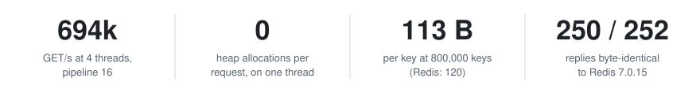
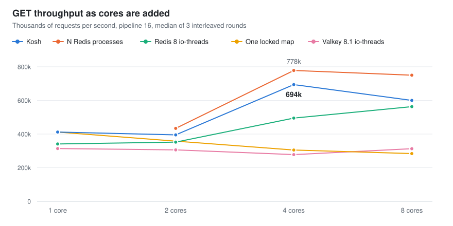
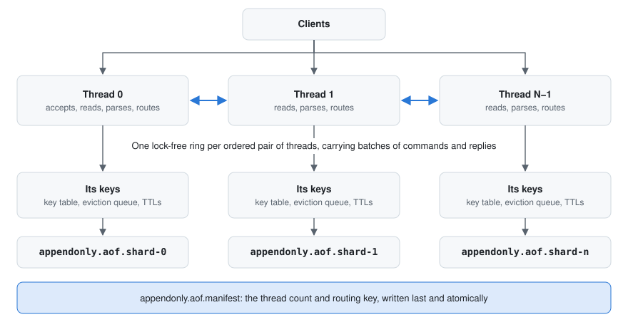

<p align="center">
  <picture>
    <source media="(prefers-color-scheme: dark)" srcset="docs/assets/logo-dark.svg">
    
  </picture>
</p>

<p align="center">
  <strong>A Redis-compatible in-memory key-value server, written from scratch in C++17.</strong><br>
  It speaks RESP2 and RESP3, works with <code>redis-cli</code>, <code>redis-py</code> and <code>node-redis</code>,<br>
  and every performance number here links to how it was measured.
</p>

<p align="center">
  <a href="https://github.com/madhavthesiya/kosh/actions/workflows/ci.yml"></a>
  <a href="https://github.com/madhavthesiya/kosh/releases"></a>
  <a href="LICENSE"></a>
</p>

<p align="center">
  <a href="#quick-start">Quick start</a> &nbsp;·&nbsp;
  <a href="#results">Results</a> &nbsp;·&nbsp;
  <a href="#how-it-works">How it works</a> &nbsp;·&nbsp;
  <a href="#whats-guaranteed">Guarantees</a> &nbsp;·&nbsp;
  <a href="#documentation">Documentation</a>
</p>

<p align="center">
  <picture>
    <source media="(prefers-color-scheme: dark)" srcset="docs/assets/stats-dark.svg">
    
  </picture>
</p>

On a laptop VM with 4 fast cores: 694,000 GET/s at 4 threads, 1.4× Redis 8 with `io-threads`. With the AOF on, SET beats Redis 8, Valkey and four separate Redis processes. Without the AOF, those four processes still win.

> [!IMPORTANT]
> **Not a Redis replacement.** It has no replication, Lua, Pub/Sub, sorted sets or TLS. [What it doesn't do](docs/COMPATIBILITY.md#known-limitations). For production, use Redis or Valkey. Use Kosh to see how a server like this is built and proven, or run `kosh-loadgen` to test any Redis-compatible server.

## Inside

<table>
  <tr>
    <td width="50%" valign="top">
      <b>Shard-per-core, built and measured</b><br>
      With <code>--threads N</code>, each thread owns its keys and sends commands for other threads through lock-free rings. At 4 cores: 2.3× the same server over one locked map. <a href="docs/ARCHITECTURE.md#several-threads">How it works</a>
    </td>
    <td width="50%" valign="top">
      <b>No heap allocation per request</b><br>
      On one thread, commands parse into reused strings, and replies and AOF records are built in place. <a href="docs/BENCHMARKS.md">Measured</a>
    </td>
  </tr>
  <tr>
    <td valign="top">
      <b>A load generator that refuses to guess</b><br>
      <code>kosh-loadgen</code> measures latency from each request's intended send time, and prints N/A rather than a percentile its own lateness would distort. <a href="bench/results/open-loop/README.md">Results</a>
    </td>
    <td valign="top">
      <b>Durability that is tested, not assumed</b><br>
      A reply means its record is with the OS. Tests kill the server under load and make writes fail at a chosen point, then check every acknowledged write. <a href="docs/ARCHITECTURE.md#3-aof-persistence">Details</a>
    </td>
  </tr>
  <tr>
    <td valign="top">
      <b>Its own hash table and eviction</b><br>
      Cache-line buckets with incremental rehashing. SIEVE misses 13–17% less than LRU on Zipf traces. <a href="docs/ARCHITECTURE.md#4-the-key-table-and-eviction">Details</a>
    </td>
    <td valign="top">
      <b>Safe by default</b><br>
      It listens on 127.0.0.1, refuses other machines unless a password is set, compares passwords in constant time, and hashes keys with a keyed SipHash so clients can't flood a bucket. <a href="SECURITY.md">Details</a>
    </td>
  </tr>
  <tr>
    <td valign="top">
      <b>Tested by trying to break it</b><br>
      ASan, UBSan, TSan, fuzzing, and a byte-for-byte comparison with Redis. The threading work alone was checked with over 70 planted bugs. <a href="docs/TESTING.md">Details</a>
    </td>
    <td valign="top">
      <b>What it serves</b><br>
      Strings, lists, sets and hashes; TTLs; <code>MULTI</code>/<code>EXEC</code>; <code>SCAN</code>; <code>INFO</code>; an AOF with three sync policies; SIEVE or LRU; <code>AUTH</code>; <code>epoll</code> on Linux and <code>select()</code> elsewhere. <a href="docs/COMMANDS.md">All commands</a>
    </td>
  </tr>
</table>

> [!TIP]
> **If you read one page:** [the bugs that shaped it](docs/DECISIONS.md), such as the 1,021st client that crashed the server, and a stall that turned out to be the memory allocator.

## Quick start

On Linux, with Git, CMake 3.16+ and a C++17 compiler:

```bash
git clone https://github.com/madhavthesiya/kosh.git && cd kosh
cmake -B build && cmake --build build -j --target kosh-server
./build/kosh-server                       # then, in another terminal: redis-cli ping
./build/kosh-server --threads 4           # or one thread per core you want to use
```

Or with Docker, no compiler needed:

```bash
docker build -t kosh https://github.com/madhavthesiya/kosh.git
docker run -d --name kosh -p 127.0.0.1:6379:6379 kosh --protected-mode no
redis-cli ping                            # PONG
```

Linux and Windows binaries are on the [releases page](https://github.com/madhavthesiya/kosh/releases). [All options, passwords, Docker and building on Windows](docs/RUNNING.md).

## Results

<picture>
  <source media="(prefers-color-scheme: dark)" srcset="docs/assets/results-dark.svg">
  
</picture>

<details>
<summary><b>The numbers behind the chart</b></summary>
<br>

| Cores | 1 | 2 | 4 | 8 |
|---|---:|---:|---:|---:|
| **Kosh** | 412 | 395 | **694** | 600 |
| The same server over one locked map | 412 | 358 | 305 | 284 |
| Redis 8.10.3 with `io-threads` | 341 | 352 | 495 | 563 |
| Valkey 8.1.11 with `io-threads` | 314 | 306 | 278 | 313 |
| N separate Redis 8.10.3 processes | – | 434 | 778 | 750 |

Peak GET throughput at pipeline 16, in thousands of requests per second, median of 3 interleaved rounds.

</details>

With the AOF on (`everysec`), SET at 4 cores: Kosh 435, four Redis processes 338, Redis 8 with `io-threads` 260, Valkey 158.

**How it was measured.** `redis-benchmark` with 1,600 connections, servers pinned to the same cores, the load generator on others, the same keys, values and persistence for every server.

**Where it doesn't win.**
- N separate Redis processes beat it on these GETs at 4 and 8 cores. They pay no routing cost, but the client has to do the sharding itself.
- More threads help only when one core is the limit. At pipeline 1 every server here stayed between 37,000 and 57,000 requests/s.
- A request that crosses threads costs more. At 20,000 requests/s, p99 was 1.47 ms on one core and 2.28 ms on four.

**Limits of these numbers.** A laptop, under WSL2, with 4 fast cores and mixed-speed others, which is likely why 8 cores does worse than 4. The load generator shares the machine, and most multi-core p99s were refused by the tool as unreliable. Runs vary: the same one-thread test gave 398,000 to 995,000.

[Full results and method](bench/results/shard-per-core/README.md)

## How it works

<picture>
  <source media="(prefers-color-scheme: dark)" srcset="docs/assets/threads-dark.svg">
  
</picture>

A connection stays on one thread. A key belongs to the thread `SipHash(key) mod N`, and a `{tag}` in a key keeps related keys together. Commands for another thread go there in a batch, run, and come back with their replies, and numbered slots keep a pipeline's replies in order. With one thread, the default, none of this exists: it is one event loop, as in Redis.

[Architecture](docs/ARCHITECTURE.md) &nbsp;·&nbsp; [Why it's built this way](docs/DECISIONS.md)

## What's guaranteed

| | One thread (default) | Several threads |
|---|---|---|
| A reply means | its record is with the OS, or on disk with `--appendfsync always` | the same, on every thread it touched |
| After a process crash | nothing acknowledged is lost | the same |
| After a power cut, `everysec` | at most about a second lost, and what remains is a prefix of history | at most about a second per thread, but the threads' files can stop at different points |
| `MSET`, `MULTI`/`EXEC` | atomic | atomic when all keys are on one thread; otherwise refused with `-CROSSSLOT` |
| `MGET`, `DEL`, `EXISTS` | atomic | each thread's part is atomic; the whole is not a snapshot |
| `SCAN` | a key present throughout is returned | the same |
| Changing the thread count | – | refused at startup: the AOF layout depends on it |

## How it grew

| When | Stage | What changed |
|---|---|---|
| Jan 2026 | Mini-Redis | A command-line cache of about 500 lines, with LRU eviction and TTLs |
| Apr–May 2026 | | Tests and thread safety, then a TCP server and an append-only file |
| Oct 2026 | `v0-baseline` | Measure first, before changing anything |
| Nov 2026 | `v1-correct` | Networking and persistence made correct |
| | `v2-fast` | `epoll`, group commit, no allocation per request |
| | `v2.5-memory` | SIEVE eviction and its own hash table |
| | 3.0.0, 3.1.0 | Safe for other people to run; the rename to Kosh; more of Redis |
| | 4.0.0 | An honest latency tool, and finally threads |

[The whole story, stage by stage](docs/HISTORY.md)

## Documentation

| Page | Read it for |
|---|---|
| [Running it](docs/RUNNING.md) | Options, passwords, Docker, building |
| [Architecture](docs/ARCHITECTURE.md) | The layers, the event loop, the AOF, the key table, threads |
| [Decisions](docs/DECISIONS.md) | The bugs that shaped it, and the trade-offs |
| [Commands](docs/COMMANDS.md) | Every command, and its complexity |
| [Compatibility](docs/COMPATIBILITY.md) | What matches Redis, and the known limitations |
| [Testing](docs/TESTING.md) | The suites, CI, sanitizers |
| [Benchmarks](docs/BENCHMARKS.md) | All results and how to run them |
| [History](docs/HISTORY.md) | From Mini-Redis to Kosh, every stage |

[Changelog](CHANGELOG.md) &nbsp;·&nbsp; [Security](SECURITY.md)

<br>

<p align="center">
  <sub>Kosh (कोश) is Sanskrit and Hindi for a treasury. Formerly Mini-Redis.<br>
  Made by <a href="https://www.linkedin.com/in/madhavthesiya/">Madhav Thesiya</a> &nbsp;·&nbsp; <a href="LICENSE">MIT License</a></sub>
</p>
