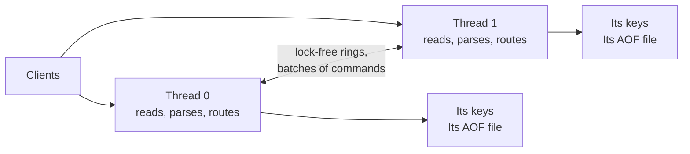

# Kosh

A Redis-compatible in-memory key-value server, written from scratch in C++17. It speaks RESP2 and RESP3, works with `redis-cli`, `redis-py` and `node-redis`, and every performance number here links to how it was measured.

On a laptop VM with 4 fast cores: 694,000 GET/s at 4 threads, 1.4× Redis 8 with `io-threads`. With the AOF on, SET beats Redis 8, Valkey and four separate Redis processes. Without the AOF, those four processes still win.

[](https://github.com/madhavthesiya/kosh/actions/workflows/ci.yml)
[](https://github.com/madhavthesiya/kosh/releases)
[](LICENSE)

*Kosh (कोश) is Sanskrit and Hindi for a treasury. Formerly Mini-Redis.*

**This is a learning project, not production software.** It has no replication, Lua, Pub/Sub, sorted sets or TLS. [What it doesn't do](docs/COMPATIBILITY.md#known-limitations). For production, use Redis or Valkey. Use Kosh to see how a server like this is built and proven, or run `kosh-loadgen` to test any Redis-compatible server.

**What's in it:** strings, lists, sets and hashes; TTLs; `MULTI`/`EXEC`; `SCAN`; `INFO`; an append-only file with three sync policies; SIEVE or LRU eviction; `AUTH` and protected mode; `epoll` on Linux and `select()` elsewhere; a Docker image, and binaries for Linux and Windows. [All commands](docs/COMMANDS.md).

**If you read one page:** [the bugs that shaped it](docs/DECISIONS.md), such as the 1,021st client that crashed the server, and a stall that turned out to be the memory allocator.

## Why it's interesting

- **Shard-per-core, built and measured.** With `--threads N`, each thread owns its keys and sends commands for other threads through lock-free rings. At 4 cores it did 694,000 GET/s: 2.3× the same server over one locked map, and 1.4× Redis 8 with `io-threads`. [How it works](docs/ARCHITECTURE.md#several-threads).
- **No heap allocation per request** on one thread. Commands parse into reused strings, and replies and AOF records are built in place. [Measured](docs/BENCHMARKS.md).
- **A load generator that refuses to guess.** `kosh-loadgen` measures latency from each request's intended send time, and prints N/A rather than a percentile its own lateness would distort. [Results](bench/results/open-loop/README.md).
- **Durability that is tested, not assumed.** A reply means its record is with the OS. Tests kill the server under load and make writes fail at a chosen point, then check every acknowledged write. [Details](docs/ARCHITECTURE.md#3-aof-persistence).
- **Its own hash table and eviction.** Cache-line buckets with incremental rehashing, 113 bytes per key at 800,000 keys (Redis: 120). SIEVE misses 13–17% less than LRU on Zipf traces. [Details](docs/ARCHITECTURE.md#4-the-key-table-and-eviction).
- **Safe by default.** It listens on 127.0.0.1, refuses other machines unless a password is set, compares passwords in constant time, and hashes keys with a keyed SipHash so clients can't flood a bucket. [Details](SECURITY.md).
- **Tested by trying to break it.** ASan, UBSan, TSan, fuzzing, and 250 of 252 cases byte-identical to Redis, with the other 2 documented. The threading work alone was checked with over 70 planted bugs. [Details](docs/TESTING.md).

## Quick start

On Linux, with Git, CMake 3.16+ and a C++17 compiler:

```bash
git clone https://github.com/madhavthesiya/kosh.git && cd kosh
cmake -B build && cmake --build build -j --target kosh-server
./build/kosh-server                       # then, in another terminal: redis-cli ping
./build/kosh-server --threads 4           # or one thread per core you want to use
```

Or with Docker, no compiler needed:

```bash
docker build -t kosh https://github.com/madhavthesiya/kosh.git
docker run -d --name kosh -p 127.0.0.1:6379:6379 kosh --protected-mode no
redis-cli ping                            # PONG
```

[All options, passwords, Docker and building on Windows](docs/RUNNING.md).

## Results

Peak GET throughput at pipeline 16, in thousands of requests per second, median of 3 interleaved rounds:

| Cores | 1 | 2 | 4 | 8 |
|---|---:|---:|---:|---:|
| **Kosh** | 412 | 395 | **694** | 600 |
| The same server over one locked map | 412 | 358 | 305 | 284 |
| Redis 8.10.3 with `io-threads` | 341 | 352 | 495 | 563 |
| Valkey 8.1.11 with `io-threads` | 314 | 306 | 278 | 313 |
| N separate Redis 8.10.3 processes | – | 434 | 778 | 750 |

With the AOF on (`everysec`), SET at 4 cores: Kosh 435, four Redis processes 338, Redis 8 with `io-threads` 260, Valkey 158.

**How it was measured:** `redis-benchmark` with 1,600 connections, servers pinned to the same cores, the load generator on others, the same keys, values and persistence for every server.

**Where it doesn't win:**
- N separate Redis processes beat it on these GETs at 4 and 8 cores. They pay no routing cost, but the client has to do the sharding itself.
- More threads help only when one core is the limit. At pipeline 1 every server here stayed between 37,000 and 57,000 requests/s.
- A request that crosses threads costs more. At 20,000 requests/s, p99 was 1.47 ms on one core and 2.28 ms on four.

**Limits of these numbers:** a laptop, under WSL2, with 4 fast cores and mixed-speed others, which is likely why 8 cores does worse than 4. The load generator shares the machine, and most multi-core p99s were refused by the tool as unreliable. Runs vary: the same one-thread test gave 398,000 to 995,000.

[Full results and method](bench/results/shard-per-core/README.md).

## How it works



A connection stays on one thread. A key belongs to the thread `SipHash(key) mod N`, and a `{tag}` in a key keeps related keys together. Commands for another thread go there in a batch, run, and come back with their replies, and numbered slots keep a pipeline's replies in order. With one thread, the default, none of this exists: it is one event loop, as in Redis.

[Architecture](docs/ARCHITECTURE.md) · [Why it's built this way](docs/DECISIONS.md)

## How it grew

Kosh began in January 2026 as Mini-Redis, a command-line cache of about 500 lines with LRU eviction and TTLs. It gained tests and thread safety, then a TCP server and an append-only file. From October 2026 it went through a long hardening: measure first, then fix networking and persistence, make it fast, rebuild how it uses memory, make it safe for other people to run, build an honest latency tool, and finally add threads. [The whole story, stage by stage](docs/HISTORY.md).

## What's guaranteed

| | One thread (default) | Several threads |
|---|---|---|
| A reply means | its record is with the OS, or on disk with `--appendfsync always` | the same, on every thread it touched |
| After a process crash | nothing acknowledged is lost | the same |
| After a power cut, `everysec` | at most about a second lost, and what remains is a prefix of history | at most about a second per thread, but the threads' files can stop at different points |
| `MSET`, `MULTI`/`EXEC` | atomic | atomic when all keys are on one thread; otherwise refused with `-CROSSSLOT` |
| `MGET`, `DEL`, `EXISTS` | atomic | each thread's part is atomic; the whole is not a snapshot |
| `SCAN` | a key present throughout is returned | the same |
| Changing the thread count | – | refused at startup: the AOF layout depends on it |

## Documentation

- [Running it](docs/RUNNING.md): options, passwords, Docker, building
- [Architecture](docs/ARCHITECTURE.md): the layers, the event loop, the AOF, the key table, threads
- [Decisions](docs/DECISIONS.md): the bugs that shaped it, and the trade-offs
- [Commands](docs/COMMANDS.md): every command, and its complexity
- [Compatibility and limitations](docs/COMPATIBILITY.md)
- [Testing](docs/TESTING.md): the suites, CI, sanitizers
- [Benchmarks](docs/BENCHMARKS.md): all results and how to run them
- [History](docs/HISTORY.md): from Mini-Redis to Kosh, every stage
- [Changelog](CHANGELOG.md) · [Security](SECURITY.md)

## License

[MIT](LICENSE).
