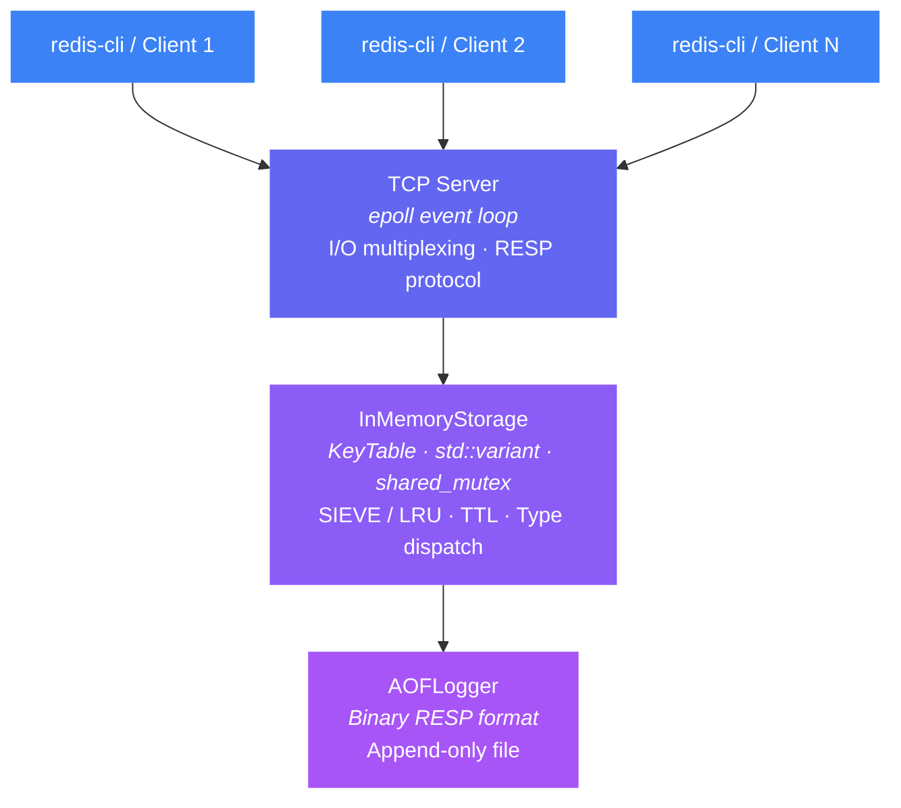
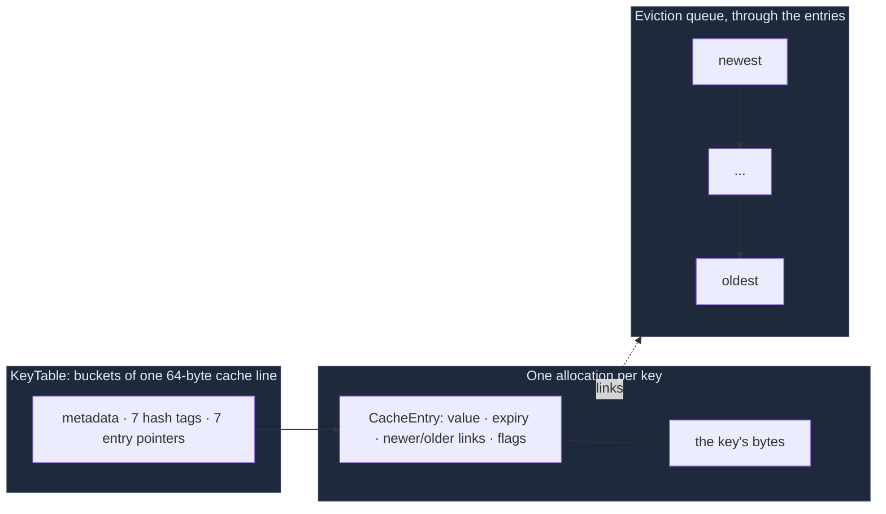

# Architecture

How Kosh is built: the layers, the event loop, the AOF, the key table, and several threads.

## Architecture



**An event loop per thread.** By default there is one: it waits on all sockets, with `epoll` on Linux (`select()` elsewhere), and runs each command to completion, so commands never race each other. Sockets are non-blocking, so the thread never waits on any one client. Redis's main thread uses the same model. With `--threads N` there is one per thread, each owning a share of the keys: see [Several threads](#several-threads).

### Layered Design

| Layer | File(s) | Responsibility |
|-------|---------|----------------|
| **Network** | `Server.h/.cpp`, `EventLoop.h/.cpp` | Accepting clients; the event loop and per-client buffers |
| **Readiness** | `Poller.h/.cpp` | Which sockets are ready: `epoll` on Linux, `select()` elsewhere, behind one interface |
| **Portability** | `Socket.h` | Winsock vs BSD sockets: types, non-blocking mode, error codes |
| **Protocol** | `RespParser.h` | RESP parsing (binary-safe, with limits) + inline command support |
| **Commands** | `Commands.h/.cpp` | One table of commands (name, number of arguments, write flag, handler), used by both the server and AOF replay |
| **Controller** | `RedisLite.h/.cpp` | Input validation, command routing for the interactive CLI |
| **Engine** | `InMemoryStorage.h/.cpp` | Entries (one allocation per key), eviction (SIEVE or LRU), TTL with an expiry index, type dispatch, AOF integration |
| **Key table** | `KeyTable.h` | The hash table: 64-byte buckets with hash tags, incremental rehashing, entries that never move |
| **Persistence** | `AOFLogger.h/.cpp`, `AofManifest.h` | Append-only file: appends, crash-safe rewrite, failed writes; with several threads, what their files mean |
| **Threads** | `SpscRing.h`, `Wakeup.h`, `Router.h` | The queue between two threads, waking a sleeping one, which thread owns a key |
| **Entry points** | `server_main.cpp`, `main.cpp` | Server (command-line flags) and interactive CLI |


## Core Features

### 1. TCP Server with RESP Protocol

Works with `redis-cli` and `redis-benchmark`: it answers the `COMMAND`, `CLIENT` and `CONFIG GET` calls they make at startup. It supports:
- **RESP arrays** (`*3\r\n$3\r\nSET\r\n...`) — binary-safe, length-prefixed
- **Inline commands** (`PING\r\n`) — for telnet/debugging
- **Per-client receive buffers** — handles TCP stream reassembly correctly
- **Pipelining** — runs every complete command found in each read, and sends all their replies with one `send()`
- **Protocol errors** — malformed input gets `-ERR Protocol error: …` and the connection is closed, as in Redis. Limits from Redis's defaults: bulk strings up to 512 MB, inline commands up to 64 KB, 1 GB of unfinished input per client
- **`TCP_NODELAY`** — disables Nagle's algorithm, so small replies aren't held back to be batched

```bash
# Connect with redis-cli
redis-cli -p 6379
127.0.0.1:6379> SET name "hello world"
OK
127.0.0.1:6379> GET name
"hello world"
```

### 2. Event Loop with Non-Blocking I/O

```
Before: accept() → handle client → BLOCKS → accept() next
After:  wait until some sockets are ready → handle those, never waiting on any one client
```

- **One thread** serves every client, with no thread per connection.
- **Non-blocking sockets:** `recv()`, `send()` and `accept()` return at once. Each client has an input buffer (bytes until they form whole commands) and an output buffer (replies until its socket takes them). A partial `send()` is normal; the rest goes when the socket is writable again.
- **Backpressure:** a client's next commands run only once its earlier replies are sent, and a batch stops at 1 MB of waiting replies. Meanwhile the server stops reading from that client, so TCP flow control slows it down. A client that never reads its replies can't stall anyone else or make the server's memory grow without limit.
- **`Poller` interface:** sockets are registered once, with what to watch for: always readability, and writability only while replies are waiting.
  - `EpollPoller` (Linux, the default): the kernel keeps the watched set, so a wait costs O(ready sockets).
  - `SelectPoller` (everywhere): each wait scans every watched socket, and on Linux it can only watch sockets numbered below 1024.
  - Both are level-triggered, so the event loop is the same for both; `--poller` chooses.
- **Group commit:** a pass of the loop reads from every ready client and runs its commands. Then one `write()` hands the OS the AOF records of all of them, and only then are the replies sent (as Redis does in `beforeSleep()`).
- **Client limit:** `--maxclients` (10,000 by default, as in Redis). A client beyond it, or beyond what `select()` can watch, gets `-ERR max number of clients reached` and is disconnected. The server raises its open-file limit at startup to fit them, and keeps a spare file descriptor to refuse clients properly if it runs out anyway (`EMFILE`).
- **No allocation per request:** commands are parsed into argument strings that are reused, replies are built straight into the client's buffer, and AOF records straight into the log's buffer. Once those have grown, a request allocates nothing (counted by [`bench/alloc_count`](../bench/alloc_count.cpp)).
- **Clean shutdown:** Ctrl+C or `SIGTERM` sets an atomic flag, the loop stops, connections and the AOF are closed, and the process exits with code 0.
- **SIGPIPE ignored (Linux/macOS):** a client that disconnects early can't kill the server. Writes to it fail with `EPIPE` instead (see Challenge 7).

### 3. AOF Persistence

Every write command is appended to `appendonly.aof` in **binary RESP format**:

```
Plain text:  "SET greeting hello world"     → BREAKS on replay (spaces)
RESP format: "*3\r\n$3\r\nSET\r\n$8\r\ngreeting\r\n$11\r\nhello world\r\n"
             ↑ length-prefixed → binary-safe ✓
```

| Feature | Details |
|---------|---------|
| Durability | Every write command's record reaches the OS before its reply is sent, so it survives a crash of the process. When it reaches the disk, which is what survives a power cut, is set by `--appendfsync`, as in Redis: `always` (synced before the reply), `everysec` (by a background thread once a second; the default) or `no` (when the OS decides). |
| Group commit | The records of every command in one pass of the event loop go out in one `write()`, and with `always` one `fdatasync()`. Measured with `strace`: 100,000 pipelined `SET`s took 132 `write()` calls, where they took 100,002; with `always`, one sync covers about 390 `SET`s at pipeline 16 and 25 without pipelining. |
| Binary safety | RESP format — spaces, newlines, any byte in values |
| Expiry times | Logged as absolute Unix times in milliseconds (`SET … PXAT`, `PEXPIREAT`), as Redis does, so a key that expired while the server was down stays expired. AOFs with the older `SETEX`/`EXPIRE` records still load. |
| Removals | Every key the server removes on its own, by eviction or because it expired, is logged as a `DEL`. Replay then rebuilds exactly the keys, values and TTLs the server held (see Challenge 11). The eviction order isn't rebuilt from the log: reads aren't logged. |
| One record per command | `MSET` and a `DEL` of several keys are each one record, so a crash mid-write leaves all of the command or none of it, as Redis's AOF does. `MSET` makes room for its keys after its record, so the evictions' `DEL`s come after it in the file, in the order replay reads them. `INCR`, `DECR` and `DECRBY` are logged as `INCRBY` with the delta: the operation, as Redis logs it, which leaves the TTL's own record as it was. |
| Replay on startup | Each record runs through the same command table as client commands. While loading, nothing expires, nothing is evicted and nothing is logged; afterwards, keys beyond `--maxkeys` are evicted, and those evictions are logged. Takes time linear in the file size. |
| Damaged file | An incomplete last record, or a transaction without its `EXEC`, left by a crash mid-write, is cut off with a warning, as Redis's `aof-load-truncated` does. Damage before the end stops startup with the byte offset of the damage and the `truncate` command that keeps everything before it. |
| Failed writes | If a write fails (a full disk), the bytes not written wait in memory, in order, and are written once the file takes them. Meanwhile, write commands get `-MISCONF Errors writing to the AOF file: …` and reads keep working, as in Redis; a failed `everysec` sync does the same. With `always`, a failed write or sync can no longer be made good, so the server sends none of the waiting replies and stops with exit code 1, as Redis does. |
| Compaction | `BGREWRITEAOF` writes the data to a temporary file, `fsync`s it, renames it over the AOF and `fsync`s the directory, so a crash at any point leaves a complete AOF. It writes the keys oldest first, so loading the new file rebuilds the eviction order. Despite the name, it runs in the foreground; see [Known Limitations](COMPATIBILITY.md#known-limitations). |
| Configuration | `--appendonly no` disables it; `--appendfilename` chooses the file; `--appendfsync` the sync policy |

### 4. The Key Table and Eviction



**The key table** (`KeyTable.h`, after Valkey 8.1's design):
- **A bucket is one 64-byte cache line:** a metadata byte, a one-byte hash tag per slot, and 7 pointers to entries.
  - A lookup reads the bucket, compares the tags, and compares the key only on a match (1 in 256 by chance).
  - That is two dependent memory reads, the bucket and the entry, where `std::unordered_map` makes three or four.
  - Measured: 103 → 50 ns per lookup at 100,000 keys, and 223 → 107 at 1,000,000 ([results](../bench/results/after-memory-fixes/README.md#3-lookups-in-the-engine)). It is 14% slower at 1,000 keys, all in cache, where only instruction count is left.
- **A full bucket's last slot points to a child bucket.**
- **It grows incrementally, as Redis's dict does:** a table twice the size, one bucket chain moved per insert or erase, and lookups checking both tables meanwhile.
  - Nothing is sized up front, and no insert moves every key: growing to 1,000,000 keys, the slowest insert took 272–405 µs (Challenge 13).
  - Big tables are mapped from the OS, the old one is given back as the rehash goes, and freed child buckets are reused (Challenge 15).
- **Entries never move:** the table holds pointers, so the eviction queue and the expiry index can point at entries.
- **Keys are hashed with SipHash-1-3 under a random key per process** (`SipHash.h`), as Python and Rust's `HashMap` do (Redis uses SipHash-1-2). Clients choose the keys. With `std::hash`, whose seed is fixed, anyone can compute keys that all land in one bucket, and then every insert walks one long chain: inserting n keys costs O(n²) ("hash flooding"). [`bench/hash_flood.cpp`](../bench/hash_flood.cpp) builds such keys and measures both the attack and the keyed hash's cost ([results](../bench/results/hash-flooding/README.md)): 40,000 colliding keys, found in 32 s on one core, take 370× as long to insert with `std::hash` as with SipHash; for ordinary keys SipHash costs 7.8 ns more per hash, and 1.10–1.15× per lookup one at a time (up to 1.92× when lookups overlap, at 1M keys). End to end, in a paired session of 4 commits, [Phase 4C as a whole showed no detectable slowdown](../bench/results/phase-4c/README.md); one SET test was 7% slower after the SipHash commit, far more than the hash itself can cost (about 10 ns per SET), so that isn't claimed as its cost. The lookup times above predate the keyed hash: they were measured with `std::hash`.

**One allocation per key:** each key is a `CacheEntry` with the key's bytes right after it.
- With 16-byte keys and 3-byte values, that is 113 bytes per key at 800,000 keys against Redis's 120 (resident memory).
- At 1,000,000 keys it is 124 against 116, because the table is in the middle of growing there.
- Before Phase 4B it was 312: four allocations per key, with the key stored twice.

**Eviction: SIEVE by default, LRU on request** (`--eviction sieve|lru`):
- Capacity is set with `--maxkeys` (default 10,000). The eviction queue runs through the entries themselves (an intrusive list), newest at the front.
- **SIEVE** (Zhang et al., NSDI 2024):
  - a hit sets a bit in the entry the lookup has just read;
  - to evict, a hand walks from the oldest key towards the newest, wrapping round, and clears the bits it passes;
  - the first key whose bit is clear is evicted, and the keys it passed keep their places.
- **LRU:** a hit relinks the entry at the front. That writes its two neighbours, memory that a big table rarely has in cache.
- **Measured** ([results](../bench/results/after-memory-fixes/README.md#5-eviction)):
  - SIEVE missed 13–17% less than LRU on Zipf traces, and 1.4–4.7% less on Twitter's production trace;
  - against what Redis 7.0.15 actually does (`allkeys-lru`: 5 sampled keys, a pool of 16, a 1-second clock, simulated from its source), SIEVE missed 13–19% less on Zipf and 5–10% less on Twitter's trace, in every seed ([results](../bench/results/redis-lru/README.md)). Redis's sampling itself comes within 1% of exact LRU; its 1-second clock costs up to 10% more misses in small caches;
  - every miss count matches a textbook LRU and the paper's SIEVE exactly;
  - engine `GET` was 10% faster with SIEVE at 1,000,000 keys, and the same at 100,000.
- **Expired keys go before live ones.** Keys with a TTL are also kept in an index ordered by expiry time (a `std::set` of expiry time and entry pointer).
  - When a new key needs room, expired keys are removed from the front of the index first, and a live key is evicted only when none is left.
  - Only as many are removed as are needed, so one insert never sweeps a large backlog.

### 5. Thread Safety

`std::shared_mutex` (reader-writer lock) — concurrent reads, exclusive writes.

| Method | Lock Type | Why |
|--------|-----------|-----|
| `GET` | `unique_lock` | Records the hit (SIEVE's bit, or LRU's relink), and lazy expiration may remove the key |
| `EXISTS` | `unique_lock` | Lazy expiration may remove the key |
| `SET`, `DEL`, `EXPIRE` | `unique_lock` | Modifies data; an insert or erase also moves one bucket chain of a rehash in progress |
| `MGET`, `MSET`, `DEL`/`EXISTS` with several keys | one `unique_lock` for the whole command | No thread sees an `MSET` or a `DEL` half done |
| `INCR` and the other counters | `unique_lock` | Read, add and write in one step: two threads' increments can't lose one |
| `TTL`, `TYPE`, `LRANGE` | `shared_lock` | Pure read: a lookup in the key table never moves anything |
| `SAVE` (CLI only) | `shared_lock` | Snapshot is read-only |

Neither mode of the server contends for this lock: with one thread there is no one to contend with, and with several each thread has its own storage. It exists so the storage engine is safe to use from several threads directly, which the stress tests do.


## Several threads

With `--threads N` (Linux, `epoll`), each thread has its own event loop, its own key table, its own eviction queue and its own AOF file. No thread touches another's keys. With one thread, the default, none of the machinery below is used.

**Which thread owns a key.** `SipHash-1-3(key) mod N`, under a random key kept in the AOF manifest. It is a different key from the tables', because a table picks its bucket from the hash's low bits: with one hash, each thread's table would use only 1/N of its buckets. If the key contains a non-empty `{tag}`, only the tag is hashed, with Redis Cluster's rule, so that keys used together can share a thread.

**How a command gets there.** Thread 0 accepts connections and deals them out in turn. A connection stays on its home thread, which reads, parses and checks the command. If the key is local it runs at once, exactly as with one thread. If not, it joins a batch for the owning thread. One bounded single-producer, single-consumer ring per ordered pair of threads ([`SpscRing.h`](../src/SpscRing.h)) carries the batches: each counter has one writer, so acquire and release are enough, with no lock and no compare-and-swap. Replies come back in the same batch, which is then reused, so nothing is allocated per command once batches have grown.

**Nothing ever waits for another thread.** At most 32 batches can be out at another thread, and a ring has room for 64, so a push can't fail. Beyond 32, commands join the waiting batch; beyond 256 replies in flight, a client stops being read, and TCP slows it down.

**Waking a sleeping thread.** [`Wakeup.h`](../src/Wakeup.h): the sender writes an eventfd only if the receiver said it is going to sleep. The receiver sets its flag and then checks for work, the sender publishes and then checks the flag, and a `seq_cst` fence on each side stops a load from overtaking the store before it, the one reordering x86 does. With one fence removed, the test lost real wakeups: TSan can't see this bug, so it has its own test.

**Replies stay in order.** Each command takes a numbered slot when it is parsed, and replies leave only from the oldest slot forward. Commands on one key stay in order because they go to one thread through one first-in, first-out ring. Commands on different keys may run in either order, which no client can observe. Replies wait for the commands outstanding when the last ones left, so a pipeline's replies leave together: that took GET at pipeline 16 from 453,000 to 691,000 requests/s at 4 threads.

**Commands that need several threads.** A *gather* reserves the client's slot, sends a part to each thread involved, and combines the answers: `DEL` and `EXISTS` add theirs, `MGET` puts each value back in the position of its key, `INFO` adds each thread's counters, `FLUSHALL` and `BGREWRITEAOF` run on every thread. `SCAN` covers one thread per call, with the thread number in the cursor's top 8 bits. Each thread sees a client's commands in the order they were sent, so a command sent to every thread lands in the right place in the client's pipeline with no extra waiting.

**Transactions and `MSET`** must have all their keys on one thread, or they are refused with `-CROSSSLOT`, as in Redis Cluster. `EXEC` then runs as one task on that thread. Making them atomic across threads would need a stop-the-world pause or a locking protocol, and a commit that spans files to survive a crash: cut as more than this project needs.

**The AOF.** One file per thread (`<aof>.shard-i`), because one shared file would make every thread queue on one lock. A thread writes its file before it publishes the replies to the commands it ran, so a reply still means what it means with one thread. `<aof>.manifest` holds the thread count and the routing key. It is written last and atomically, so a manifest means every file exists, and a missing file is lost data. Replay checks that each key belongs to its file. The thread count can't change between restarts: a key's thread depends on it, and moving keys between files would need a rewrite of all of them.

Measured against Redis 8, Valkey 8.1 and N Redis processes in [`bench/results/shard-per-core`](../bench/results/shard-per-core/README.md).
